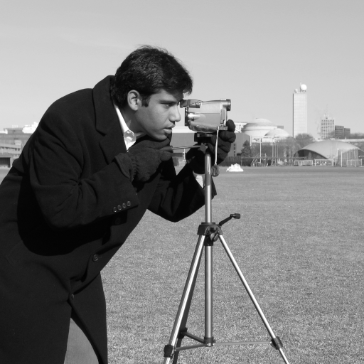
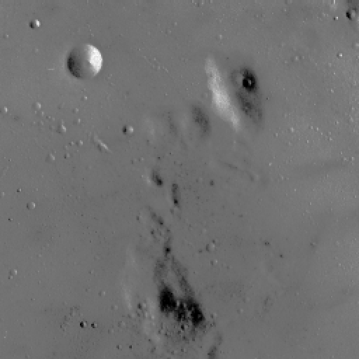

# Digital Image Processing: Degradation → Restoration → Enhancement

A **Python / OpenCV** program that takes clean images, **adds noise** to them, **removes** it with
8 different filtering methods, **enhances** the contrast and **measures with numbers**
(PSNR / SSIM) how well each step worked.


<sub>The full pipeline on the Cameraman image, from left to right: original → noisy →
after the filter → after enhancement → edges before and after restoration. In the bottom row
(10% Salt & Pepper noise) the Median filter raises PSNR from 14.8 to 29.6 dB and edge
detection accuracy (F1) from 0.41 to 0.94.</sub>

---

## The idea in plain words

When a photo is noisy, there are dozens of filters that promise to clean it up.
Which one is best? This project answers **experimentally**:

1. It starts from **clean images**, which serve as the "right answer" (ground truth).
2. It adds **known, controlled noise** to them.
3. It tries each filter and **compares the result with the original image**.

Because the original image is known, every result is measured objectively instead of being
judged "by eye".

| Metric | What it measures | Better |
|---|---|---|
| **PSNR** (dB) | How close the pixels are to the original image | Higher (>30 dB = very good) |
| **SSIM** (0–1) | How similar the image structure (edges, texture) looks to the human eye | Closer to 1 |

## The two images

They were chosen to be **deliberately opposite**, so it shows when a filter helps and when it hurts.

| Cameraman | Moon |
|---|---|
|  |  |
| Strong edges and texture: this is where the **cost** of blurring shows | Smooth, low contrast: this is where the **gain** of enhancement shows |

Both come from the built-in `scikit-image` dataset (free CC0 license), so they load offline
and the results can be reproduced on any computer.

## The 8 stages

| # | Stage | What happens | Results |
|---|---|---|---|
| 1 | **Reference images** | Loading, conversion to 512×512 grayscale, histograms | [`stage1_reference`](results/stage1_reference) |
| 2 | **Degradation** | Gaussian noise (σ = 10, 25) and Salt & Pepper (2%, 10%) → 8 noisy images | [`stage2_degradation`](results/stage2_degradation) |
| 3 | **Frequency analysis** | FFT spectrum: which frequencies the image "lives" in and which the noise does | [`stage3_fft`](results/stage3_fft) |
| 4 | **Spatial filters** | Gaussian, Median, Bilateral, testing several window sizes | [`stage4_spatial`](results/stage4_spatial) |
| 5 | **Frequency filters** | Ideal, Butterworth (n = 1, 2, 5) and Gaussian low-pass | [`stage5_frequency`](results/stage5_frequency) |
| 6 | **Enhancement** | Histogram Equalization and CLAHE on the cleaned images | [`stage6_enhancement`](results/stage6_enhancement) |
| 7 | **Edge detection** | Sobel and Canny, before and after restoration | [`stage7_edges`](results/stage7_edges) |
| 8 | **Overall evaluation** | One table with PSNR / SSIM at every step of the pipeline | [`stage8_summary`](results/stage8_summary) |

## What we found

The best filter for each image and noise type ([full table](results/stage8_summary/pipeline_summary.md)):

| Image | Noise | Noisy PSNR | Best filter | PSNR after | SSIM after |
|---|---|---:|---|---:|---:|
| Cameraman | Gaussian σ=10 | 28.22 | Bilateral | **32.09** | 0.865 |
| Cameraman | Gaussian σ=25 | 20.58 | Bilateral | **27.86** | 0.674 |
| Cameraman | S&P 2% | 21.76 | Median 3×3 | **30.40** | 0.867 |
| Cameraman | S&P 10% | 14.75 | Median 3×3 | **29.58** | 0.858 |
| Moon | Gaussian σ=10 | 28.12 | Bilateral | **37.94** | 0.907 |
| Moon | Gaussian σ=25 | 20.17 | Butterworth n=2 | **34.59** | 0.879 |
| Moon | S&P 2% | 22.91 | Median 3×3 | **40.42** | 0.964 |
| Moon | S&P 10% | 15.91 | Median 3×3 | **39.72** | 0.965 |

**Key takeaways:**

- **There is no one filter for everything.** Median wins in all 4 Salt & Pepper cases.
  For Gaussian noise, Bilateral or Butterworth wins.
- **The type of noise matters.** For Gaussian noise, spatial and frequency filters are only
  ~1 dB apart. For Salt & Pepper, Median is 2.8–7.1 dB better than any frequency filter,
  because isolated "dots" cannot be separated out in the frequency domain.
- **Clean first, enhance second.** CLAHE on the noisy Moon gives SSIM 0.048;
  on the cleaned one it gives 0.506. Enhancement amplifies whatever it finds, noise included.
- **Restoration has practical value.** On Moon with 10% noise, edge detection rises
  from F1 = 0.32 to 0.96. Noise does not hide the edges; it creates false ones.
- **PSNR drops after enhancement, and that is expected.** CLAHE deliberately changes the
  brightness values so that more detail becomes visible, so it moves away pixel-by-pixel
  from the original. Enhancement is not a restoration step.


## Running it

You need Python 3 and the packages in `requirements.txt` (numpy, OpenCV, matplotlib, scikit-image).

```bash
python -m pip install -r requirements.txt
```

```bash
python main.py               # the whole pipeline (a few minutes)
python main.py --stage 4     # a single stage
python main.py --stage 1 2   # selected stages
```

All results (images, plots, `.csv` and `.md` tables) are written to the `results/` folder,
one subfolder per stage. The numbers are **the same on every run**, because the noise is
generated with a fixed seed (`RANDOM_SEED = 631`).

Correctness checks (no extra dependencies):

```bash
python tests/test_invariants.py
```

## Code structure

```
main.py                     command line: picks which stages to run
requirements.txt
src/
  stages/                   one module per stage (stage1_reference.py … stage8_summary.py),
                            each with a run() that writes results/stageN_.../
  config.py                 all experiment parameters in one place
  io_utils.py               loading / converting / saving images
  degradation.py            Stage 2: Gaussian & Salt-and-Pepper noise
  frequency_filters.py      Stages 3 & 5: FFT, Ideal / Butterworth / Gaussian low-pass
  spatial_filters.py        Stage 4: Gaussian / Median / Bilateral
  enhancement.py            Stage 6: Histogram Equalization, CLAHE
  edges.py                  Stage 7: Sobel, Canny
  metrics.py                PSNR / SSIM
  viz.py                    plots (images, histograms, grids)
  tables.py                 result tables (terminal / .csv / .md)
tests/
  test_invariants.py        properties that must hold by definition of the methods
tools/
  preview_candidates.py     preview of candidate reference images
images/                     the reference images (PNG)
results/                    all results, per stage
```

<details>
<summary><b>Mapping to the assignment requirements</b></summary>

| Requirement | Where it is implemented | Output |
|---|---|---|
| 1. ≥2 reference images with different characteristics | `config.REFERENCE_IMAGES` | `results/stage1_reference/` |
| 2. Gaussian (≥2 σ) & S&P (≥2 d) + histograms | `src/degradation.py` | `results/stage2_degradation/` |
| 3. FFT magnitude spectrum of original & degraded | `src/frequency_filters.py` | `results/stage3_fft/` |
| 4. Gauss (≥2 kernels), Median (≥2 windows), bilateral + PSNR/SSIM | `src/spatial_filters.py` | `results/stage4_spatial/` |
| 5. Butterworth (**≥2 orders n**) & Gaussian LPF, kernels + PSNR/SSIM | `src/frequency_filters.py` | `results/stage5_frequency/` |
| 6. HE + CLAHE (≥2 clipLimit) **on the denoised images** + histograms before/after | `src/enhancement.py` | `results/stage6_enhancement/` |
| 7. Sobel (horizontal/vertical/combined) & Canny (≥2 thresholds) **on the restored image** | `src/edges.py` | `results/stage7_edges/` |
| 8. Summary table of PSNR/SSIM per step | `src/stages/stage8_summary.py` | `results/stage8_summary/pipeline_summary.csv` |

</details>

<details>
<summary><b>Technical conventions</b></summary>

- All images: **grayscale, uint8, [0, 255], 512×512**.
- Computations are done in `float64` and converted back to `uint8` with clipping.
- Fixed `RANDOM_SEED = 631` with a separate generator per experiment, so that the noise (and
  therefore PSNR/SSIM) is reproducible and independent of the order in which stages run.

</details>
