<div class="cover">

<p class="uni">ΠΑΝΕΠΙΣΤΗΜΙΟ — ΤΜΗΜΑ ΗΛΕΚΤΡΟΛΟΓΩΝ ΜΗΧΑΝΙΚΩΝ &amp; ΜΗΧΑΝΙΚΩΝ Η/Υ</p>

<p class="course">ΕΥ631 — Ψηφιακή Επεξεργασία Εικόνας</p>

# Υποβάθμιση, Αποκατάσταση και Βελτίωση Ψηφιακής Εικόνας

<p class="subtitle">Πειραματική μελέτη σε χωρικό πεδίο και πεδίο συχνοτήτων,<br>με αντικειμενική αξιολόγηση σε 8 περιπτώσεις υποβάθμισης</p>

<p class="author">
<strong>Ονοματεπώνυμο:</strong> ⟨συμπληρώστε⟩<br>
<strong>Αριθμός Μητρώου:</strong> ⟨συμπληρώστε⟩<br>
<strong>Ακαδημαϊκό έτος:</strong> 2025–2026
</p>

<p class="date">Τελική Εργασία · Σεπτέμβριος 2026</p>

</div>

<div class="pagebreak"></div>

## Περίληψη

Η εργασία υλοποιεί και αξιολογεί πειραματικά μια πλήρη αλυσίδα ψηφιακής επεξεργασίας
εικόνας: **τεχνητή υποβάθμιση → αποκατάσταση → βελτίωση → ανίχνευση ακμών**. Ως εικόνες
αναφοράς επιλέχθηκαν δύο σκόπιμα αντίθετες περιπτώσεις — η *Cameraman* (υψηλή αντίθεση,
πλούσια υψίσυχνη λεπτομέρεια) και η *Moon* (χαμηλή αντίθεση, ομαλές διαβαθμίσεις) — και
υποβλήθηκαν σε τέσσερις υποβαθμίσεις δύο διαφορετικών φύσεων: προσθετικό γκαουσιανό θόρυβο
(σ = 10, 25) και κρουστικό θόρυβο τύπου salt-and-pepper (d = 2 %, 10 %), δηλαδή **8
περιπτώσεις μελέτης** συνολικά.

Για κάθε περίπτωση εκτελέστηκε εξαντλητική σάρωση παραμέτρων: 96 πειράματα χωρικών φίλτρων
(Gaussian, Median, Bilateral), 360 πειράματα φίλτρων συχνοτήτων (ιδανικό, Butterworth
τάξεων n = 1, 2, 5 και γκαουσιανό χαμηλοπερατό, σε 9 συχνότητες αποκοπής), και τελική
συγκριτική αξιολόγηση **57 μεθόδων αποκατάστασης ανά περίπτωση**. Η αξιολόγηση έγινε με
MSE / PSNR / SSIM, με συμπληρωματικά μέτρα ευκρίνειας, εντροπίας και αξιοποίησης δυναμικής
περιοχής, και τελικά με **precision / recall / F1 σε ανίχνευση ακμών** — μια πραγματική
εργασία όρασης που κρίνει αν η αποκατάσταση απέδωσε πέρα από τους δείκτες.

**Τα κύρια ευρήματα.** (α) Δεν υπάρχει καθολικά βέλτιστο φίλτρο: το Median κερδίζει και
στις 4 περιπτώσεις κρουστικού θορύβου, το Bilateral / Butterworth και στις 4 περιπτώσεις
γκαουσιανού, χωρίς καμία εξαίρεση. (β) Η βέλτιστη συχνότητα αποκοπής **προβλέπεται** από
την ανάλυση φάσματος του Σταδίου 3 και επαληθεύεται σε **8/8** περιπτώσεις, χωρίς ανάγκη
δοκιμών. (γ) Η επιλογή πεδίου (χωρικό ή συχνοτήτων) είναι πρακτικά αδιάφορη για τον
γκαουσιανό θόρυβο (±1 dB, όπως επιβάλλει το θεώρημα συνέλιξης) αλλά κρίσιμη για τον
κρουστικό (+2,8 έως +7,1 dB υπέρ του χωρικού). (δ) Η αποκατάσταση αποδεικνύεται χρήσιμη
στην πράξη: το F1 ανίχνευσης ακμών ανεβαίνει από 0,318 σε 0,956 στη δυσκολότερη περίπτωση.
(ε) Η βελτίωση αντίθεσης έχει **χαμηλότερο** PSNR από την αποκατάσταση, και αυτό είναι
αναμενόμενο, όχι σφάλμα: μετρήθηκε με τα σωστά μεγέθη (εντροπία, επίπεδα γκρι σε χρήση:
69 % → 97 %).

Όλα τα αριθμητικά αποτελέσματα είναι πλήρως αναπαραγώγιμα (`RANDOM_SEED = 631` με ανά
πείραμα γεννήτρια τυχαίων αριθμών).

<div class="pagebreak"></div>

## Περιεχόμενα

[TOC]

<div class="pagebreak"></div>

## 1. Εισαγωγή

### 1.1 Το πρόβλημα

Κάθε πραγματική εικόνα φτάνει στον υπολογιστή αλλοιωμένη. Ο αισθητήρας προσθέτει θερμικό
και φωτονικό θόρυβο, το κανάλι μετάδοσης προκαλεί σφάλματα, η οπτική διάταξη θολώνει.
Η ψηφιακή επεξεργασία εικόνας απαντά σε αυτό με δύο **διαφορετικές** οικογένειες τεχνικών,
που συχνά συγχέονται:

- **Αποκατάσταση (restoration).** Πρόβλημα *αντιστροφής*. Υποθέτουμε γνωστό μοντέλο
  υποβάθμισης και προσπαθούμε να προσεγγίσουμε την άγνωστη αρχική εικόνα. Έχει
  **αντικειμενικό** κριτήριο επιτυχίας: η απόσταση από την εικόνα αναφοράς (PSNR, SSIM).
- **Βελτίωση (enhancement).** Δεν υπάρχει «σωστή απάντηση». Στόχος είναι μια εικόνα πιο
  **χρήσιμη** για έναν παρατηρητή ή για τον επόμενο αλγόριθμο. Μια πετυχημένη βελτίωση
  μπορεί κάλλιστα να απομακρύνεται από την αναφορά — και συνήθως απομακρύνεται.

Η εργασία αυτή δεν εξετάζει τις δύο οικογένειες χωριστά· τις τοποθετεί σε **αλυσίδα** και
μετρά τι προσφέρει η καθεμία, με ποια σειρά, και με ποιο κόστος.

### 1.2 Στόχοι

1. Να μοντελοποιηθεί τεχνητή υποβάθμιση δύο **διαφορετικών φύσεων** (στατιστική και
   κρουστική) σε ελεγχόμενες εντάσεις, ώστε να υπάρχει γνωστό ground truth.
2. Να αναλυθεί η υποβάθμιση στο **πεδίο συχνοτήτων** και να εξαχθεί από εκεί πρόβλεψη για
   τον σχεδιασμό των φίλτρων.
3. Να συγκριθεί η αποκατάσταση στο **χωρικό πεδίο** (φίλτρα συνέλιξης και τάξης) με την
   αποκατάσταση στο **πεδίο συχνοτήτων** (χαμηλοπερατά φίλτρα), με ίδια κριτήρια.
4. Να εφαρμοστεί **βελτίωση αντίθεσης** και να τεκμηριωθεί πειραματικά η σωστή θέση της
   μέσα στην αλυσίδα.
5. Να κριθεί όλη η αλυσίδα με **ανίχνευση ακμών** — μια πραγματική εργασία όρασης, όχι μόνο
   έναν δείκτη ποιότητας.
6. Όλα τα παραπάνω με **αναπαραγώγιμα** πειράματα και σάρωση παραμέτρων, όχι με μεμονωμένες
   αυθαίρετες επιλογές.

### 1.3 Δομή της εργασίας σε στάδια

Η υλοποίηση οργανώνεται σε οκτώ στάδια που εκτελούνται διαδοχικά και τροφοδοτούν το ένα το
άλλο:

| Στάδιο | Αντικείμενο | Έξοδος που χρησιμοποιείται παρακάτω |
|---|---|---|
| 1 | Εικόνες αναφοράς (ground truth) | οι 2 καθαρές εικόνες |
| 2 | Τεχνητή υποβάθμιση + μετρικές | 8 υποβαθμισμένες εικόνες |
| 3 | Ανάλυση FFT / φάσματος | η ακτίνα `r(SNR=1)` → Στάδιο 5 |
| 4 | Αποκατάσταση, χωρικό πεδίο | βέλτιστο χωρικό φίλτρο ανά περίπτωση |
| 5 | Αποκατάσταση, πεδίο συχνοτήτων | βέλτιστο χαμηλοπερατό ανά περίπτωση |
| 6 | Βελτίωση αντίθεσης (HE / CLAHE) | σειρά αλυσίδας, τελική εικόνα |
| 7 | Ανίχνευση ακμών (Sobel / Canny) | F1 ως τελικό κριτήριο |
| 8 | Συγκεντρωτική αξιολόγηση | συγκριτικοί πίνακες & συμπεράσματα |

<div class="pagebreak"></div>

## 2. Μεθοδολογία και υλοποίηση

### 2.1 Συμβάσεις

Όλη η εργασία δουλεύει με **grayscale εικόνες uint8 στο [0, 255], μεγέθους 512×512**. Το
τετράγωνο μέγεθος διευκολύνει τον DFT του Σταδίου 3. Κάθε πράξη πραγματοποιείται εσωτερικά
σε `float64` και το αποτέλεσμα επιστρέφει σε uint8 με **clipping** στο [0, 255] — το
clipping δεν είναι υπολογιστική παραδοχή αλλά μέρος του φυσικού μοντέλου (κορεσμός
αισθητήρα). Η αποθήκευση γίνεται πάντα σε **PNG (lossless)**: τα artifacts μιας συμπίεσης
JPEG θα μολύνανε τις μετρήσεις θορύβου.

### 2.2 Αναπαραγωγιμότητα

Ο σπόρος τυχαιότητας είναι σταθερός (`RANDOM_SEED = 631`), αλλά — κρίσιμο σημείο — **δεν
χρησιμοποιείται μία κοινή γεννήτρια**. Κάθε πείραμα παίρνει τη δική του γεννήτρια μέσω της
`degradation.rng_for(image_key, variant_key)`, σπαρμένη ντετερμινιστικά από τον κύριο σπόρο.
Έτσι ο θόρυβος μιας συγκεκριμένης περίπτωσης είναι **ίδιος ανεξάρτητα από το ποια και πόσα
στάδια έτρεξαν πριν**. Με μία κοινή γεννήτρια, το `python main.py --stage 2` θα έδινε
διαφορετικά PSNR από το `python main.py --stage 1 2`, και καμία σύγκριση δεν θα ήταν
ασφαλής.

### 2.3 Οργάνωση του κώδικα

```text
main.py                     ενορχηστρωτής — run_stage1() … run_stage8()
src/config.py               όλες οι παράμετροι των πειραμάτων σε ένα σημείο
src/io_utils.py             φόρτωση / μετατροπή / αποθήκευση
src/metrics.py              MSE, PSNR, SSIM, εντροπία, ευκρίνεια
src/viz.py                  εικόνες, ιστογράμματα, πλέγματα, καμπύλες, ραβδογράμματα
src/tables.py               πίνακες → τερματικό / .csv / .md
src/degradation.py          Στάδιο 2 — γκαουσιανός & salt-and-pepper θόρυβος
src/frequency_filters.py    Στάδια 3 & 5 — FFT, ιδανικό / Butterworth / γκαουσιανό ΧΠΦ
src/spatial_filters.py      Στάδιο 4 — Gaussian / Median / Bilateral
src/enhancement.py          Στάδιο 6 — γραμμική διάταση, HE, CLAHE
src/edges.py                Στάδιο 7 — Sobel, Canny, αξιολόγηση χάρτη ακμών
results/stageN_.../         όλες οι εικόνες και οι πίνακες κάθε σταδίου
```

Η επιλογή να μπουν **όλες** οι παράμετροι στο `config.py` δεν είναι καλλωπισμός: επιτρέπει
να αλλάξει ένα πείραμα (π.χ. να προστεθεί τάξη Butterworth) και η αλλαγή να διαδοθεί
αυτόματα σε σάρωση, γκαλερί πυρήνων και τελική σύγκριση, χωρίς να ξεχαστεί κάποιο σημείο.

### 2.4 Μετρικές αξιολόγησης

Για δύο εικόνες `f` (αναφορά) και `g` (υπό εξέταση), μεγέθους M×N:

| Μέγεθος | Ορισμός | Τι μετρά — και πού αποτυγχάνει |
|---|---|---|
| **MSE** | `(1/MN)·Σ(f − g)²` | μέσο τετραγωνικό σφάλμα ανά pixel |
| **PSNR** (dB) | `10·log₁₀(255² / MSE)` | λόγος σήματος προς θόρυβο· **τιμωρεί δυσανάλογα** λίγες ακραίες αποκλίσεις (τετραγωνίζει), άρα είναι κακός κριτής για κρουστικό θόρυβο |
| **SSIM** | τοπική σύγκριση φωτεινότητας, αντίθεσης, δομής | **δομική** ομοιότητα· πλησιάζει την ανθρώπινη αντίληψη |
| **Ευκρίνεια** | `Var(∇²g)` ως % της τιμής της αναφοράς | πόση υψίσυχνη δομή απέμεινε· τιμή **>100 %** σημαίνει υπόλειμμα θορύβου, όχι επιτυχία |
| **Εντροπία** | `−Σ p·log₂p` του ιστογράμματος | πληροφορία σε bits· **ο θόρυβος την ανεβάζει**, άρα συγκρίνεται μόνο μεταξύ εικόνων με τον ίδιο θόρυβο |
| **Επίπεδα σε χρήση** | % των 256 επιπέδων με μη μηδενική συχνότητα | αξιοποίηση δυναμικής περιοχής |
| **P / R / F1** | επί του χάρτη ακμών, με ανοχή θέσης 2 pixel | ποιότητα ανίχνευσης ακμών ως τελικό κριτήριο χρησιμότητας |

Η **αρχή που διατρέχει όλη την εργασία** είναι ότι καμία μεμονωμένη μετρική δεν αρκεί.
Θα δούμε περιπτώσεις όπου PSNR και SSIM δίνουν διαφορετικό νικητή, και μία όπου το PSNR
ανεβαίνει ενώ το SSIM πέφτει.

<div class="pagebreak"></div>
## 3. Στάδιο 1 — Εικόνες αναφοράς

### 3.1 Επιλογή και προετοιμασία

Επιλέχθηκαν δύο εικόνες από τη συλλογή `skimage.data` (διαθέσιμες offline, χωρίς εξωτερική
λήψη): η `camera` (*Cameraman*) και η `moon` (*Moon*). Και οι δύο μετατράπηκαν σε grayscale
uint8 και αναδιαστάθηκαν σε 512×512.

Η επιλογή δεν είναι τυχαία: οι δύο εικόνες είναι σκόπιμα **αντίθετες**, ώστε κάθε τεχνική
που ακολουθεί να δοκιμάζεται σε δύο άκρα του φάσματος περιεχομένου.

**Πίνακας 1 — Χαρακτηριστικά των εικόνων αναφοράς**

| Εικόνα | Μέση τιμή | Τυπική απόκλιση | Μέσο \|∇\| (Sobel) | Ακμές Canny |
|---|---|---|---|---|
| Cameraman | 129,06 | 73,64 | 49,30 | 7,51 % |
| Moon | 112,17 | 13,33 | 14,84 | 0,44 % |

<figure>
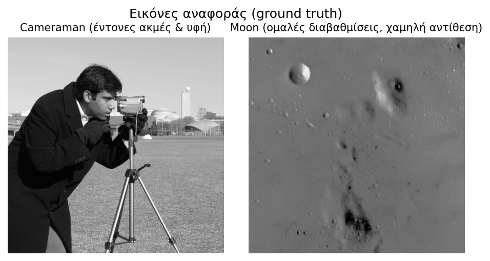
<figcaption><strong>Εικόνα 1.</strong> Οι δύο εικόνες αναφοράς (ground truth): Cameraman και Moon.</figcaption>
</figure>

<figure>
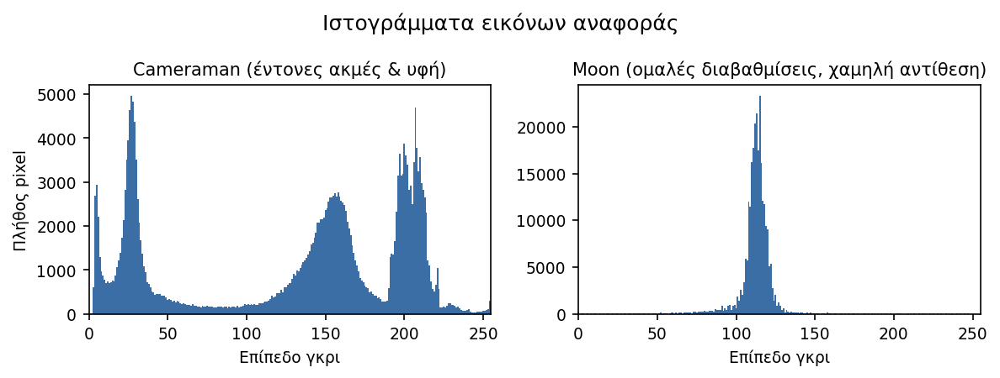
<figcaption><strong>Εικόνα 2.</strong> Ιστογράμματα των εικόνων αναφοράς. Το πλατύ ιστόγραμμα του Cameraman έναντι του πολύ στενού της Moon είναι η ποσοτική εικόνα της διαφοράς αντίθεσης.</figcaption>
</figure>

### 3.2 Σχολιασμός

- Η **Cameraman** έχει τυπική απόκλιση 73,6 — πλατύ ιστόγραμμα, υψηλή αντίθεση. Το μεγάλο
  μέσο μέτρο κλίσης (49,3) και το 7,5 % ακμών σημαίνουν πλούσια υψίσυχνη πληροφορία
  (τρίποδο, κτίρια, υφή γρασιδιού). Εδώ θα φανεί το **κόστος** των χαμηλοπερατών φίλτρων:
  ό,τι εξομάλυνση αφαιρεί θόρυβο, αφαιρεί και πραγματική λεπτομέρεια.
- Η **Moon** έχει τυπική απόκλιση μόλις 13,3 και σχεδόν καθόλου ακμές (0,44 %). Είναι η
  τυπική «χαμηλής αντίθεσης» εικόνα όπου θα λάμψουν οι τεχνικές βελτίωσης του Σταδίου 6 —
  και όπου, όπως θα δούμε, ο ίδιος θόρυβος πονάει πολύ περισσότερο, γιατί είναι
  συγκρίσιμος με το ίδιο το σήμα.

Δύο μεγέθη αξίζουν προσοχή γιατί επανέρχονται σε όλη την εργασία: η **τυπική απόκλιση του
ιστογράμματος** ως μέτρο αντίθεσης, και το **μέσο μέτρο κλίσης** ως ένδειξη του πόσο
«υψίσυχνη» είναι μια εικόνα.

<div class="pagebreak"></div>

## 4. Στάδιο 2 — Τεχνητή υποβάθμιση

### 4.1 Τα δύο μοντέλα θορύβου

Υλοποιήθηκαν δύο μοντέλα **διαφορετικής φύσης**, όχι δύο εντάσεις του ίδιου:

**Προσθετικός γκαουσιανός θόρυβος**

```text
g(x,y) = f(x,y) + n(x,y),    n ~ N(0, σ²),    σ ∈ {10, 25}
```

Μοντελοποιεί θερμικό θόρυβο αισθητήρα και θόρυβο ενισχυτή. Μεταβάλλει **κάθε** pixel, αλλά
**λίγο**.

**Κρουστικός θόρυβος salt-and-pepper**

```text
ποσοστό d των pixel αντικαθίσταται: τα μισά με 255 (salt), τα μισά με 0 (pepper)
d ∈ {2 %, 10 %}
```

Μοντελοποιεί σφάλματα μετάδοσης και ελαττωματικά στοιχεία αισθητήρα. Μεταβάλλει **ελάχιστα**
pixel, αλλά **ακραία**.

Το γινόμενο 2 εικόνες × 4 παραλλαγές δίνει τις **8 περιπτώσεις μελέτης** που ακολουθούν
την εργασία ως το τέλος.

### 4.2 Αποτελέσματα

**Πίνακας 2 — Μετρικές υποβάθμισης**

| Εικόνα | Υποβάθμιση | Pixel που άλλαξαν | σ̂ θορύβου | max\|Δ\| | PSNR (dB) | SSIM |
|---|---|---|---|---|---|---|
| Cameraman | Gauss σ=10 | 95,95 % | 9,89 | 47 | 28,22 | 0,6101 |
| Cameraman | Gauss σ=25 | 98,35 % | 23,85 | 118 | 20,58 | 0,3020 |
| Cameraman | S&P d=2 % | 1,99 % | 20,82 | 255 | 21,76 | 0,6291 |
| Cameraman | S&P d=10 % | 9,98 % | 46,66 | 255 | 14,75 | 0,1917 |
| Moon | Gauss σ=10 | 96,01 % | 10,01 | 45 | 28,12 | 0,4442 |
| Moon | Gauss σ=25 | 98,38 % | 25,00 | 111 | 20,17 | 0,1277 |
| Moon | S&P d=2 % | 1,99 % | 18,24 | 255 | 22,91 | 0,4795 |
| Moon | S&P d=10 % | 10,03 % | 40,82 | 255 | 15,91 | 0,0695 |

<figure>
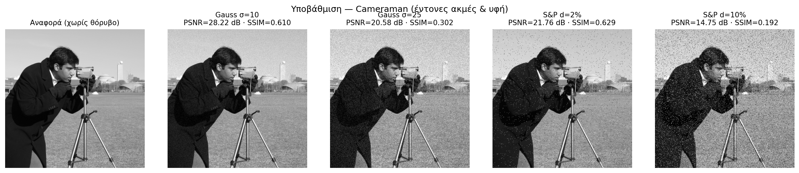
<figcaption><strong>Εικόνα 3.</strong> Cameraman: αναφορά και οι τέσσερις υποβαθμίσεις, με PSNR/SSIM στους τίτλους.</figcaption>
</figure>

<figure>
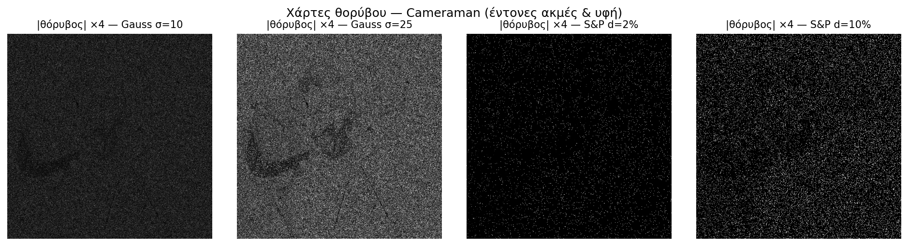
<figcaption><strong>Εικόνα 4.</strong> Χάρτες θορύβου |g − f| (×4). Πυκνό «χιόνι» παντού για τον γκαουσιανό, αραιές φωτεινές κουκκίδες για τον S&amp;P: η οπτική εκδοχή της διαφοράς «στατιστικός έναντι κρουστικού».</figcaption>
</figure>

<figure>
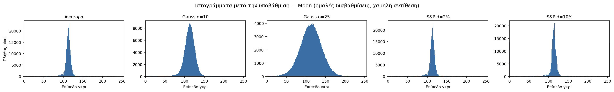
<figcaption><strong>Εικόνα 5.</strong> Moon: επίδραση στο ιστόγραμμα. Ο γκαουσιανός θόρυβος <em>απλώνει</em> το ιστόγραμμα (συνέλιξη με γκαουσιανή), ενώ ο S&amp;P προσθέτει δύο <em>αιχμές-δέλτα</em> στο 0 και στο 255 αφήνοντας το υπόλοιπο σχήμα άθικτο.</figcaption>
</figure>

### 4.3 Σχολιασμός

1. **Επαλήθευση του μοντέλου.** Το εκτιμώμενο σ̂ βγαίνει σχεδόν ακριβώς όσο ζητήθηκε
   (9,89 ≈ 10· 23,85 ≈ 25) και το ποσοστό των αλλαγμένων pixel 1,99 % ≈ 2 % και
   10,03 % ≈ 10 %. Η μικρή υποεκτίμηση στο σ = 25 οφείλεται στο **clipping** στο [0, 255],
   που κόβει τις ακραίες ουρές του θορύβου.
2. **Η στήλη max|Δ| διαχωρίζει τις δύο φύσεις.** Γκαουσιανός: κάθε pixel, μεταβολή ~3σ–5σ.
   S&P: ελάχιστα pixel, μεταβολή πάντα 255. Ο πρώτος είναι **στατιστικός**, ο δεύτερος
   είναι **outliers** — και αυτό καθορίζει ποιο φίλτρο θα δουλέψει στο Στάδιο 4.
3. **PSNR και SSIM διαφωνούν, και η διαφωνία είναι διδακτική.** Στον Cameraman, το
   S&P d = 2 % έχει *χειρότερο* PSNR (21,76) από τον γκαουσιανό σ = 10 (28,22) αλλά
   *καλύτερο* SSIM (0,629 έναντι 0,610). Το PSNR στηρίζεται στο MSE, που τετραγωνίζει και
   άρα τιμωρεί αλύπητα τις λίγες ακραίες αποκλίσεις. Το SSIM μετρά δομή: στο S&P το 98 %
   της εικόνας μένει **ανέγγιχτο**, ενώ ο γκαουσιανός διαβρώνει τη δομή παντού.
4. **Η Moon πληγώνεται περισσότερο στο SSIM** (0,444 έναντι 0,610 του Cameraman για τον ίδιο
   θόρυβο), παρότι το PSNR είναι σχεδόν ίδιο. Ο λόγος είναι ο τοπικός λόγος σήματος προς
   θόρυβο: με τυπική απόκλιση σήματος 13,3, ένας θόρυβος σ = 10 είναι **συγκρίσιμος με το
   ίδιο το σήμα**. Στον Cameraman (73,6) χάνεται μέσα στην αντίθεση.

**Πρόβλεψη για τα Στάδια 4–5.** Ο γκαουσιανός θόρυβος είναι ευρυζωνικός/λευκός στο πεδίο
συχνοτήτων και άρα αντιμετωπίζεται με γραμμικά φίλτρα. Ο S&P είναι κρουστικός: τα γραμμικά
φίλτρα δεν τον αφαιρούν, τον **απλώνουν** στους γείτονες· χρειάζεται φίλτρο τάξης (median),
που απορρίπτει τα outliers εξ ορισμού.

<div class="pagebreak"></div>

## 5. Στάδιο 3 — Ανάλυση στο πεδίο συχνοτήτων

### 5.1 Τι υπολογίστηκε

Για κάθε εικόνα αναλύθηκαν πέντε εκδοχές (αναφορά + 4 υποβαθμισμένες) με κεντραρισμένο DFT
(`fftshift`, δηλαδή DC στο κέντρο): φάσμα πλάτους σε λογαριθμική κλίμακα, **ακτινικό προφίλ
ισχύος**, **αθροιστική ενέργεια ανά ακτίνα**, και η ακτίνα όπου η ισχύς του θορύβου
εξισώνεται με την ισχύ του σήματος, `r(SNR=1)`. Αναλύθηκε επιπλέον το φάσμα **του ίδιου του
θορύβου** (`g − f`), για άμεση επιβεβαίωση ότι είναι λευκός.

### 5.2 Τέσσερις σχεδιαστικές αποφάσεις

1. **Λογαριθμική κλίμακα στο φάσμα.** Η συνιστώσα DC είναι τάξεις μεγέθους πάνω από τις
   υπόλοιπες· χωρίς `log(1+|F|)` θα βλέπαμε μία λευκή κουκκίδα σε μαύρο φόντο.
2. **Αποκλεισμός της DC από τις μετρήσεις ενέργειας.** Η DC κουβαλά τη *μέση φωτεινότητα*,
   όχι δομή. Αν την κρατούσαμε, το «90 % της ενέργειας» θα βρισκόταν μέσα σε ακτίνα ~0,01
   για **κάθε** εικόνα και η μέτρηση δεν θα ξεχώριζε τίποτα. Αφαιρώντας την, μετράμε την
   ενέργεια των **μεταβολών**.
3. **Μέση ισχύς ανά δακτύλιο, όχι άθροισμα.** Οι μεγάλες ακτίνες περιέχουν πολύ
   περισσότερους συντελεστές, οπότε το άθροισμα θα τις ευνοούσε τεχνητά.
4. **Κανονικοποίηση ακτίνας στο Nyquist:** `r = 0` είναι η DC και `r = 1` η μέγιστη
   συχνότητα κατά τους άξονες. Οι γωνίες του τετράγωνου φάσματος φτάνουν ως `r = √2`,
   γι' αυτό εμφανίζονται τιμές > 1.

### 5.3 Αποτελέσματα

**Πίνακας 3 — Κατανομή ενέργειας στο φάσμα**

| Εικόνα | Εκδοχή | Ενέργεια σε r>0,25 | r(90 %) | r(95 %) | r(99 %) | r(SNR=1) |
|---|---|---|---|---|---|---|
| Cameraman | Αναφορά | 2,92 % | 0,061 | 0,157 | 0,566 | — |
| Cameraman | Gauss σ=10 | 4,56 % | 0,080 | 0,227 | 0,887 | 0,713 |
| Cameraman | Gauss σ=25 | 11,96 % | 0,406 | 0,823 | 1,119 | 0,370 |
| Cameraman | S&P d=2 % | 9,96 % | 0,249 | 0,732 | 1,088 | 0,403 |
| Cameraman | S&P d=10 % | 32,99 % | 0,945 | 1,055 | 1,246 | 0,249 |
| Moon | Αναφορά | 5,35 % | 0,146 | 0,265 | 0,798 | — |
| Moon | Gauss σ=10 | 37,91 % | 0,964 | 1,072 | 1,254 | 0,271 |
| Moon | Gauss σ=25 | 75,80 % | 1,083 | 1,174 | 1,306 | 0,138 |
| Moon | S&P d=2 % | 64,64 % | 1,055 | 1,152 | 1,295 | 0,193 |
| Moon | S&P d=10 % | 87,99 % | 1,105 | 1,193 | 1,315 | 0,094 |

<figure>
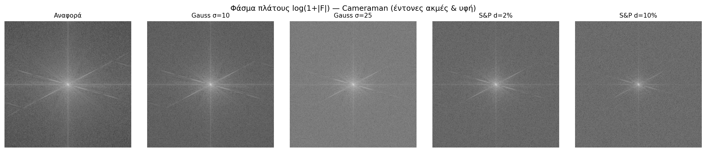
<figcaption><strong>Εικόνα 6.</strong> Cameraman: φάσματα πλάτους log(1+|F|) της αναφοράς και των τεσσάρων υποβαθμισμένων εκδοχών.</figcaption>
</figure>

<figure>
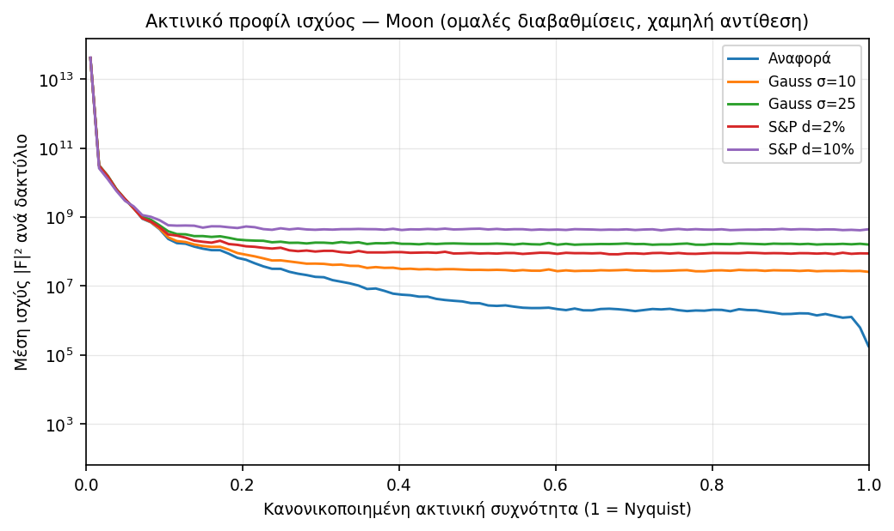
<figcaption><strong>Εικόνα 7.</strong> Moon — ακτινικό προφίλ ισχύος. Οι θορυβώδεις καμπύλες ταυτίζονται με την καθαρή στις χαμηλές συχνότητες και μετά <strong>επιπεδώνονται σε οριζόντιο πλατό</strong>: αυτός είναι ο ορισμός του λευκού θορύβου. Η καθαρή εικόνα πέφτει μονότονα.</figcaption>
</figure>

<figure>
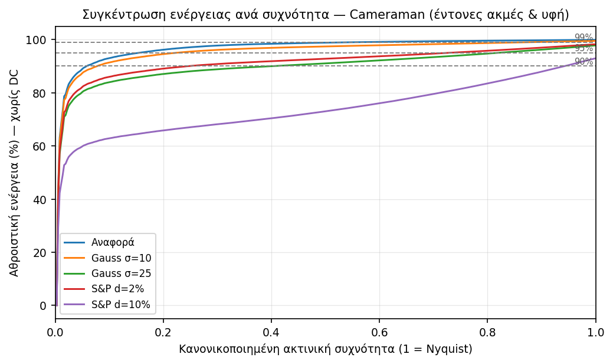
<figcaption><strong>Εικόνα 8.</strong> Cameraman — αθροιστική ενέργεια ανά ακτίνα. Στην καθαρή εικόνα το 90 % της ενέργειας χωράει μέσα σε ακτίνα 0,061.</figcaption>
</figure>

### 5.4 Σχολιασμός

1. **Οι φυσικές εικόνες είναι χαμηλοπερατές.** Στην καθαρή Cameraman μόλις **2,92 %** της
   ενέργειας βρίσκεται πέρα από `r = 0,25`, και το 90 % χωράει σε ακτίνα **0,061** — δηλαδή
   σε ~0,4 % του εμβαδού του φάσματος. Αυτή η ασυμμετρία είναι η βάση τόσο της συμπίεσης
   εικόνας (JPEG) όσο και κάθε χαμηλοπερατής αποθορυβοποίησης.
2. **Ο θόρυβος είναι λευκός, και φαίνεται.** Το οριζόντιο πλατό των θορυβωδών καμπυλών
   (Εικόνα 7) σημαίνει ίδια ισχύς σε κάθε συχνότητα.
3. **Το πλατό ανεβαίνει με το σ².** Από σ = 10 σε σ = 25 η καμπύλη ανεβαίνει περίπου ×6,
   δηλαδή (25/10)² — ακριβώς όπως προβλέπει η θεωρία.
4. **Ο S&P είναι κι αυτός ευρυζωνικός.** Στο φάσμα μοιάζει με λευκό θόρυβο, γι' αυτό ένα
   χαμηλοπερατό φίλτρο *κάτι* θα κάνει· αλλά στο πεδίο του χώρου παραμένει ακραίες
   μεμονωμένες τιμές. Αυτή η διπλή φύση εξηγεί προκαταβολικά γιατί στο Στάδιο 5 τα
   χαμηλοπερατά θα βελτιώσουν το PSNR **χωρίς όμως** να πλησιάσουν το median: ένα impulse
   απλωμένο σε 25 pixel εξακολουθεί να είναι σφάλμα.
5. **Η Moon πλήττεται δραματικά περισσότερο.** Ο ίδιος θόρυβος (σ = 10) ανεβάζει την ενέργεια
   υψηλών συχνοτήτων της Moon από 5,35 % σε **37,91 %**, ενώ του Cameraman μόνο από 2,92 %
   σε 4,56 %. Η Moon έχει ελάχιστη δική της ενέργεια εκεί, οπότε ο θόρυβος **κυριαρχεί**.
   Είναι η ίδια παρατήρηση με το χαμηλό SSIM του Σταδίου 2, ιδωμένη από το πεδίο συχνοτήτων.
6. **Η στήλη `r(SNR=1)` είναι το παραδοτέο προς το Στάδιο 5.** Δείχνει πού η ισχύς του
   θορύβου ξεπερνά την ισχύ του σήματος· πέρα από εκεί κόβουμε σχεδόν αποκλειστικά θόρυβο.
   Η τιμή **δεν είναι σταθερά**: 0,71 για Cameraman/σ = 10 (κόψε λίγο, υπάρχει χρήσιμη
   λεπτομέρεια), 0,09 για Moon/S&P 10 % (κόψε επιθετικά). **Όσο χειρότερος ο θόρυβος και
   όσο πιο ομαλή η εικόνα, τόσο χαμηλότερη η συχνότητα αποκοπής.**

<div class="pagebreak"></div>
## 6. Στάδιο 4 — Αποκατάσταση στο χωρικό πεδίο

### 6.1 Τα τρία φίλτρα

Επιλέχθηκαν τρία φίλτρα **διαφορετικής λογικής**, όχι τρεις παραλλαγές του ίδιου:

| Φίλτρο | Είδος | Αρχή λειτουργίας |
|---|---|---|
| **Gaussian** | γραμμικό (συνέλιξη) | σταθμισμένος μέσος όρος γειτονιάς· ο μέσος όρος N ανεξάρτητων δειγμάτων μειώνει το σ κατά **√N** |
| **Median** | μη γραμμικό, φίλτρο τάξης | επιστρέφει τη διάμεσο της γειτονιάς· απορρίπτει outliers (σημείο κατάρρευσης 50 %) |
| **Bilateral** | μη γραμμικό, edge-preserving | διπλός πυρήνας: χωρική εγγύτητα **×** ομοιότητα έντασης· δεν σταθμίζει πάνω από ακμές |

Αντί για μία αυθαίρετη παράμετρο ανά φίλτρο, έγινε **σάρωση**: 4 μεγέθη πυρήνα ανά
οικογένεια × 4 υποβαθμίσεις × 2 εικόνες = **96 πειράματα** (`spatial_sweep.csv`).

### 6.2 Δύο μεθοδολογικές αποφάσεις

1. **Κάθε οικογένεια κρίνεται στο δικό της βέλτιστο.** Διαφορετικά θα «καταδικάζαμε» ένα
   φίλτρο επειδή του δώσαμε κακή παράμετρο — σφάλμα σχεδιασμού πειράματος, όχι εύρημα.
2. **Δεύτερη μετρική δίπλα στο PSNR.** Το φιλτράρισμα σχεδόν πάντα ανεβάζει το PSNR όσο
   αφαιρεί θόρυβο, αλλά αφαιρεί μαζί και λεπτομέρεια. Χωρίς μέτρο **ευκρίνειας** το κόστος
   μένει αόρατο.

### 6.3 Αποτελέσματα

**Πίνακας 4 — Καλύτερο αποτέλεσμα ανά οικογένεια (PSNR σε dB, με τη βέλτιστη παράμετρο)**

| Εικόνα | Υποβάθμιση | PSNR πριν | Gaussian | Median | Bilateral |
|---|---|---|---|---|---|
| Cameraman | Gauss σ=10 | 28,22 | 30,23 (3×3) | 29,26 (3×3) | **32,09** (σc=25) |
| Cameraman | Gauss σ=25 | 20,58 | 27,17 (5×5) | 26,31 (5×5) | **27,86** (σc=50) |
| Cameraman | S&P d=2 % | 21,76 | 27,64 (3×3) | **30,40** (3×3) | 26,45 |
| Cameraman | S&P d=10 % | 14,75 | 23,92 (7×7) | **29,58** (3×3) | 21,45 |
| Moon | Gauss σ=10 | 28,12 | 37,53 (7×7) | 36,39 (5×5) | **37,94** (σc=25) |
| Moon | Gauss σ=25 | 20,17 | 33,82 (9×9) | 33,52 (9×9) | **34,00** (σc=100) |
| Moon | S&P d=2 % | 22,91 | 35,37 (9×9) | **40,42** (3×3) | 36,31 |
| Moon | S&P d=10 % | 15,91 | 30,28 (9×9) | **39,72** (3×3) | 29,49 |

Ευκρίνεια στα ίδια βέλτιστα, ως % της αναφοράς (Cameraman / Gauss σ = 25):
Gaussian **13,8 %**, Median 25,3 %, Bilateral **71,1 %**.

<figure>
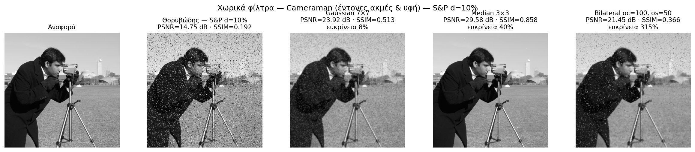
<figcaption><strong>Εικόνα 9.</strong> Cameraman / S&amp;P d = 10 %: σύγκριση των τριών φίλτρων στα βέλτιστά τους. Το Median καθαρίζει πλήρως τα impulses· το Gaussian τα <em>απλώνει</em> σε κηλίδες· το Bilateral τα αφήνει σχεδόν ανέπαφα, επειδή τα εκλαμβάνει ως ακμές προς διατήρηση.</figcaption>
</figure>

<figure>
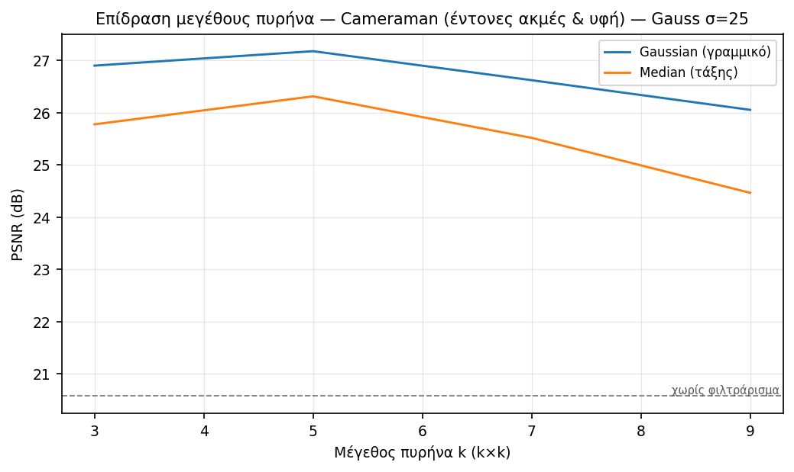
<figcaption><strong>Εικόνα 10.</strong> PSNR συναρτήσει του μεγέθους πυρήνα (Cameraman / Gauss σ = 25). Η <strong>κορυφή</strong> κάθε καμπύλης είναι το σημείο ισορροπίας του συμβιβασμού bias–variance.</figcaption>
</figure>

<figure>
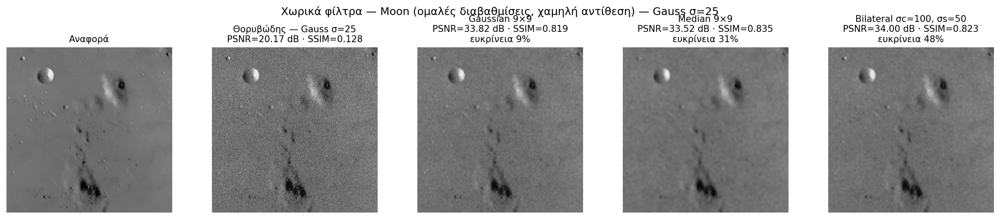
<figcaption><strong>Εικόνα 11.</strong> Moon / Gauss σ = 25: στην ομαλή εικόνα και τα τρία φίλτρα αποδίδουν πολύ (+13 dB και άνω), γιατί η υπόθεση «οι γείτονες μοιάζουν» ισχύει σχεδόν παντού.</figcaption>
</figure>

### 6.4 Σχολιασμός

1. **Το κεντρικό εύρημα: κάθε θόρυβος θέλει το φίλτρο του.** Στον γκαουσιανό θόρυβο νικά
   το Bilateral (Gaussian δεύτερο, Median τελευταίο). Στον S&P το Median κερδίζει
   **συντριπτικά**: +23,82 dB στη Moon / d = 10 %, έναντι +14,37 του Gaussian και +13,59 του
   Bilateral — διαφορά ~10 dB, δηλαδή **δεκαπλάσια μείωση του MSE**.
   *Γιατί:* ένα impulse τιμής 255 μέσα σε παράθυρο 3×3 μετακινεί τον μέσο όρο κατά ~28
   μονάδες. Το γραμμικό φίλτρο δεν το αφαιρεί — το **απλώνει σε 9 pixel**. Η διάμεσος το
   βρίσκει στην άκρη της ταξινομημένης λίστας και το **απορρίπτει**.
2. **Το βέλτιστο μέγεθος πυρήνα μεγαλώνει με τον θόρυβο** (Cameraman: 3×3 → 5×5· Moon:
   7×7 → 9×9). Είναι ο κλασικός συμβιβασμός **bias–variance**: μεγαλύτερο παράθυρο σημαίνει
   καλύτερη εκτίμηση μέσης τιμής αλλά και μεγαλύτερο θόλωμα.
3. **Μία εξαίρεση που επιβεβαιώνει τον κανόνα:** για το Median στον S&P το βέλτιστο είναι
   **πάντα 3×3**, ακόμη και στο d = 10 %. Η διάμεσος δεν χρειάζεται μεγάλο δείγμα —
   χρειάζεται μόνο τα καθαρά pixel να είναι **πλειοψηφία** στο παράθυρο (στο 10 %, περίπου
   8 από 9). Μεγαλύτερο παράθυρο προσθέτει μόνο θόλωμα.
4. **Η ευκρίνεια αποκαλύπτει το κρυφό κόστος.** Στο Cameraman / σ = 25 το Gaussian 5×5
   αφήνει μόλις **13,8 %** της αρχικής ευκρίνειας ενώ το Bilateral **71,1 %** — για
   *καλύτερο* PSNR. Αυτό ακριβώς σημαίνει «edge-preserving».
5. **Ευκρίνεια > 100 % είναι προειδοποίηση, όχι επιτυχία.** Στο Bilateral με S&P η ευκρίνεια
   βγαίνει 315 % και 545 %. Το φίλτρο δεν «πρόσθεσε λεπτομέρεια»: **αρνήθηκε να αγγίξει τα
   impulses**, γιατί η μεγάλη διαφορά έντασης από τους γείτονες τα κάνει να μοιάζουν με
   ακμές. Δίδαγμα: **η διατήρηση ακμών γίνεται μειονέκτημα όταν ο θόρυβος μοιάζει με ακμή.**
6. **Η Moon κερδίζει πολύ περισσότερο από κάθε φίλτρο** (+23,8 dB έναντι +14,8 του Cameraman
   στην ίδια υποβάθμιση), γιατί είναι ομαλή: η υπόθεση πάνω στην οποία στηρίζεται **κάθε**
   χωρικό φίλτρο ισχύει σχεδόν παντού. Στον Cameraman καταρρέει σε κάθε ακμή.

**Σύνδεση με τα Στάδια 3 και 5.** Το γκαουσιανό φίλτρο εδώ και το γκαουσιανό χαμηλοπερατό
του Σταδίου 5 είναι **η ίδια πράξη** (θεώρημα συνέλιξης). Το ότι το βέλτιστο μέγεθος πυρήνα
μεγαλώνει με τον θόρυβο είναι **η ίδια παρατήρηση** με το ότι το `r(SNR=1)` μικραίνει:
μεγάλος πυρήνας ⇔ χαμηλή συχνότητα αποκοπής.

<div class="pagebreak"></div>

## 7. Στάδιο 5 — Αποκατάσταση στο πεδίο συχνοτήτων

### 7.1 Τα φίλτρα

Τα χαμηλοπερατά φίλτρα ορίζονται ως συναρτήσεις μεταφοράς `H(D)` που εξαρτώνται μόνο από
την απόσταση `D` από την DC:

| Φίλτρο | Συνάρτηση μεταφοράς | Χαρακτηριστικό |
|---|---|---|
| **Ιδανικό** | `H = 1` αν `D ≤ D0`, αλλιώς `0` | απότομη αποκοπή → πυρήνας sinc στον χώρο |
| **Butterworth** | `H = 1 / (1 + (D/D0)^(2n))`, n = 1, 2, 5 | στο `D0` πάντα `H = 0,5`· το `n` ρυθμίζει την **απότομη** της μετάβασης |
| **Γκαουσιανό** | `H = exp(−D² / (2·D0²))` | ποτέ ringing (ο ΜΦ γκαουσιανής είναι γκαουσιανή) |

Το φιλτράρισμα είναι απλός πολλαπλασιασμός `G = H·F` και αντίστροφος DFT — **θεώρημα
συνέλιξης**. Κάθε τάξη Butterworth αντιμετωπίζεται ως **ξεχωριστή οικογένεια**, με δική της
σάρωση `D0` και δικά της PSNR/SSIM. Συνολικά: 9 συχνότητες αποκοπής × 5 φίλτρα × 4
υποβαθμίσεις × 2 εικόνες = **360 πειράματα** (`frequency_sweep.csv`).

<figure>
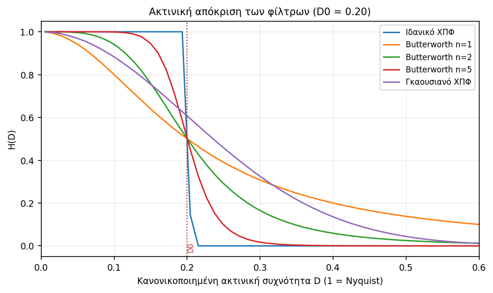
<figcaption><strong>Εικόνα 12.</strong> Ακτινικές αποκρίσεις των πέντε χαμηλοπερατών φίλτρων στην ίδια συχνότητα αποκοπής. Όλα τα Butterworth περνούν από το ίδιο σημείο H = 0,5 στο D0· αυτό που αλλάζει με το n είναι μόνο η κλίση της μετάβασης.</figcaption>
</figure>

<figure>
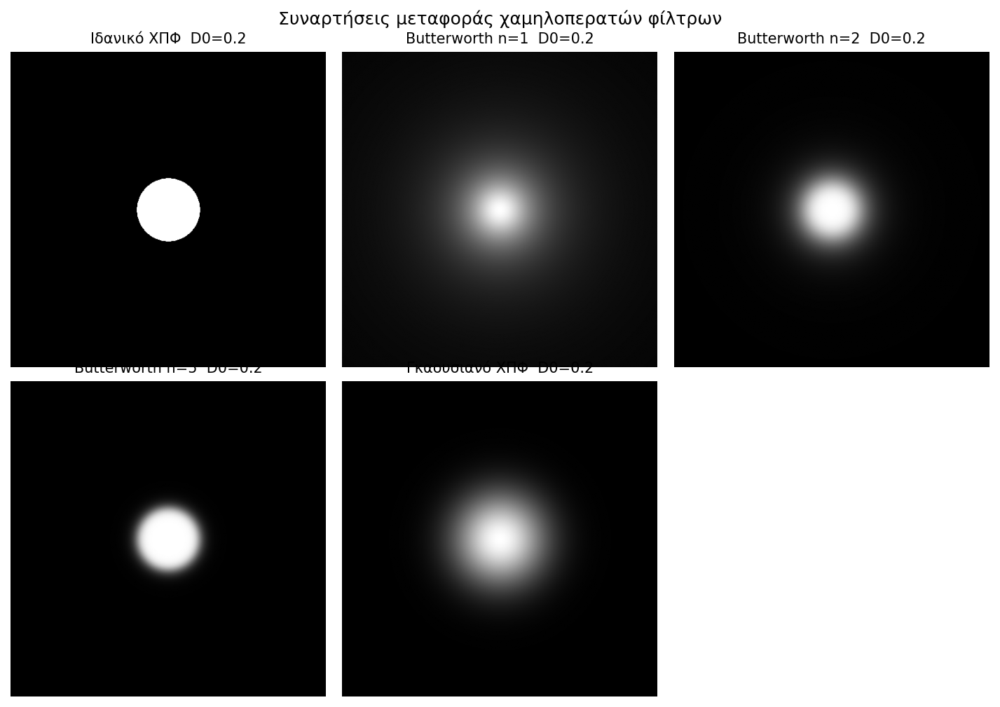
<figcaption><strong>Εικόνα 13.</strong> Οι ίδιες συναρτήσεις μεταφοράς ως δισδιάστατες μάσκες στο επίπεδο συχνοτήτων.</figcaption>
</figure>

### 7.2 Αποτελέσματα

**Πίνακας 5 — Βέλτιστο PSNR (dB) ανά φίλτρο, με τη βέλτιστη συχνότητα αποκοπής**

| Εικόνα | Υποβάθμιση | r(SNR=1) *πρόβλεψη Στ. 3* | Ιδανικό | Butter. n=1 | Butter. n=2 | Butter. n=5 | Γκαουσιανό |
|---|---|---|---|---|---|---|---|
| Cameraman | Gauss σ=10 | **0,713** | 29,46 @ 0,75 | **31,10** @ 0,75 | 31,02 @ 0,75 | 30,35 @ 0,75 | **31,10** @ 0,60 |
| Cameraman | Gauss σ=25 | **0,370** | 25,87 @ 0,30 | 26,84 @ 0,45 | 26,94 @ 0,45 | 26,44 @ 0,45 | **26,97** @ 0,30 |
| Cameraman | S&P d=2 % | **0,403** | 26,51 @ 0,45 | 27,52 @ 0,45 | **27,59** @ 0,45 | 27,09 @ 0,45 | 27,47 @ 0,45 |
| Cameraman | S&P d=10 % | **0,249** | 22,96 @ 0,30 | 23,60 @ 0,20 | 23,67 @ 0,30 | 23,39 @ 0,30 | **23,75** @ 0,20 |
| Moon | Gauss σ=10 | **0,271** | 36,45 @ 0,30 | 37,24 @ 0,20 | **37,40** @ 0,30 | 37,01 @ 0,30 | **37,40** @ 0,20 |
| Moon | Gauss σ=25 | **0,138** | 33,62 @ 0,15 | 34,37 @ 0,15 | **34,59** @ 0,15 | 34,16 @ 0,15 | 34,48 @ 0,15 |
| Moon | S&P d=2 % | **0,193** | 34,52 @ 0,20 | 35,40 @ 0,15 | 35,44 @ 0,20 | 35,05 @ 0,20 | **35,54** @ 0,15 |
| Moon | S&P d=10 % | **0,094** | 32,09 @ 0,10 | 32,37 @ 0,10 | **32,67** @ 0,10 | 32,41 @ 0,10 | 32,53 @ 0,10 |

<figure>
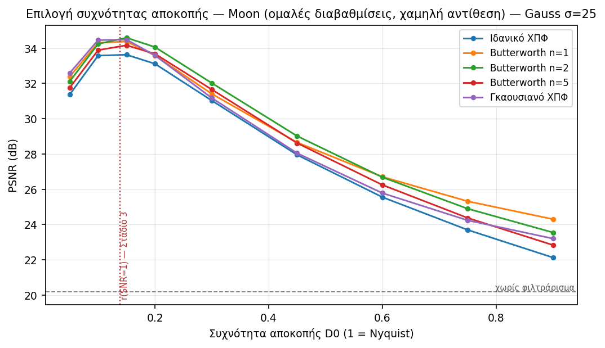
<figcaption><strong>Εικόνα 14.</strong> PSNR συναρτήσει της συχνότητας αποκοπής (Moon / Gauss σ = 25). Η κατακόρυφη διακεκομμένη γραμμή είναι η <strong>πρόβλεψη r(SNR=1) του Σταδίου 3</strong> — περνά πάνω από την κορυφή των καμπυλών.</figcaption>
</figure>

<figure>
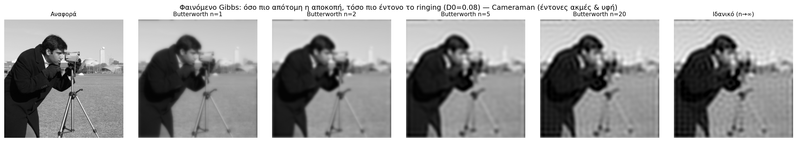
<figcaption><strong>Εικόνα 15.</strong> Επίδειξη του φαινομένου Gibbs με <strong>σταθερή</strong> συχνότητα αποκοπής: n = 1 και n = 2 καθαρά, n = 5 αρχίζει, n = 20 και ιδανικό γεμάτα ομόκεντρους κυματισμούς. Το ringing δεν το προκαλεί το «πόσο» κόβουμε, αλλά το «πόσο απότομα».</figcaption>
</figure>

### 7.3 Σχολιασμός

1. **Η πρόβλεψη του Σταδίου 3 επαληθεύτηκε — και είναι το ισχυρότερο εύρημα της εργασίας.**
   Το βέλτιστο `D0` πέφτει στο ίδιο σημείο του πλέγματος με το `r(SNR=1)` σε **8 από τις 8**
   περιπτώσεις: 0,75↔0,713 · 0,30↔0,370 · 0,45↔0,403 · 0,30↔0,249 · 0,30↔0,271 ·
   0,15↔0,138 · 0,20↔0,193 · 0,10↔0,094. Δεν είναι σύμπτωση: το `r(SNR=1)` είναι εξ ορισμού
   το σημείο όπου η ισχύς του θορύβου ξεπερνά την ισχύ του σήματος, άρα πέρα από εκεί κάθε
   συχνότητα που κρατάμε προσθέτει περισσότερο σφάλμα από πληροφορία. **Η συχνότητα αποκοπής
   δεν χρειάζεται να βρεθεί με δοκιμές — προκύπτει από την ανάλυση φάσματος.**
2. **Το ιδανικό φίλτρο χάνει σε κάθε γραμμή**, σταθερά ~1 dB κάτω από τα ομαλά. Αιτία το
   **φαινόμενο Gibbs**: απότομη αποκοπή στις συχνότητες ⇒ πυρήνας **sinc** στον χώρο, με
   ουρές που ταλαντώνονται και παράγουν «απόηχους» γύρω από τις ακμές (Εικόνα 15).
3. **Η τάξη n του Butterworth: το n = 2 είναι η σωστή επιλογή, τεκμηριωμένα.** Νικά σε
   **7 από τις 8** περιπτώσεις· στη μοναδική εξαίρεση το n = 1 προηγείται κατά 0,08 dB,
   δηλαδή στα όρια του θορύβου μέτρησης. Το **n = 5 χάνει και στις 8**. Η εξήγηση είναι
   πάλι το Gibbs: όσο μεγαλώνει το n, τόσο το φίλτρο πλησιάζει το ιδανικό — μαζί με το
   ringing του. Το n = 1 υστερεί για τον αντίθετο λόγο: η μετάβασή του είναι τόσο ομαλή που
   αφήνει θόρυβο να περάσει πάνω από το D0. **Το n δεν είναι παράμετρος «όσο μεγαλύτερη τόσο
   καλύτερα»: υπάρχει βέλτιστο, και βρίσκεται χαμηλά.**
4. **Το γκαουσιανό δεν κάνει ποτέ ringing**, γιατί ο μετασχηματισμός Fourier μιας γκαουσιανής
   είναι γκαουσιανή — θετική παντού, χωρίς ταλαντώσεις.
5. **Το D0 δεν συγκρίνεται απευθείας μεταξύ οικογενειών.** Στο ίδιο D0 το Butterworth δίνει
   H = 0,5 ενώ το γκαουσιανό `exp(−0,5) ≈ 0,61` — διαφορετικό πραγματικό εύρος ζώνης. Γι'
   αυτό το γκαουσιανό βρίσκει συχνά το βέλτιστό του σε μικρότερο D0 με το **ίδιο** PSNR.
   Συγκρίνουμε αποτελέσματα, όχι ετικέτες παραμέτρων.
6. **Σύγκριση με το Στάδιο 4.** Στον γκαουσιανό θόρυβο τα δύο πεδία δίνουν πρακτικά το ίδιο
   (Moon σ = 25: 34,59 dB στις συχνότητες έναντι 33,82 dB χωρικά· η μικρή διαφορά οφείλεται
   στο ότι το D0 ρυθμίζεται συνεχώς ενώ το μέγεθος πυρήνα μόνο σε βήματα των 2). **Στον S&P
   όμως το χωρικό Median κυριαρχεί**: Moon / d = 10 % δίνει **39,72 dB** έναντι **32,67 dB**
   του καλύτερου χαμηλοπερατού — διαφορά **7 dB**. Το impulse είναι πρόβλημα του πεδίου του
   **χώρου** και απλώνεται σε ολόκληρο το φάσμα· κανένα φίλτρο συχνοτήτων δεν μπορεί να το
   απομονώσει.
7. **Το κόστος σε ευκρίνεια είναι δραματικό στη Moon** (1,2 %–4,5 % της αρχικής): για να
   πέσει το D0 στο 0,10 πετάμε ουσιαστικά όλη τη λεπτομέρεια. Το PSNR ανεβαίνει +16,76 dB
   επειδή η Moon **δεν είχε** πολλή λεπτομέρεια εκεί — σε εικόνα τύπου Cameraman η ίδια
   επιλογή θα ήταν καταστροφική.
8. **Μία αρνητική τιμή αξίζει προσοχή:** Cameraman / S&P 2 % με ιδανικό φίλτρο δίνει
   **ΔSSIM = −0,0106** — το PSNR ανέβηκε κατά 4,75 dB αλλά η δομική ομοιότητα
   **χειροτέρεψε**. Το ringing πρόσθεσε ψευδείς δομές που το SSIM τις «βλέπει» ενώ το MSE
   τις υποτιμά.

<div class="pagebreak"></div>
## 8. Στάδιο 6 — Βελτίωση αντίθεσης

### 8.1 Η εννοιολογική διάκριση

Πριν από κάθε αριθμό, χρειάζεται να ξεκαθαριστεί γιατί αυτό το στάδιο **δεν κρίνεται με
PSNR**:

- Η **αποκατάσταση** (Στάδια 4–5) προσπαθεί να πλησιάσει το άγνωστο ground truth. Έχει
  αντικειμενικό κριτήριο και το PSNR/SSIM **πρέπει** να ανεβαίνει.
- Η **βελτίωση** κάνει την εικόνα πιο χρήσιμη για έναν παρατηρητή. Μια πετυχημένη βελτίωση
  έχει **χειρότερο** PSNR ως προς την αναφορά, γιατί σκόπιμα αλλάζει τις εντάσεις. Εδώ
  μετράμε **αντίθεση (std)**, **εντροπία** και **αξιοποίηση δυναμικής περιοχής**.

### 8.2 Τι υλοποιήθηκε

Τρεις τεχνικές: **γραμμική διάταση αντίθεσης** (baseline), **καθολική ισοστάθμιση
ιστογράμματος (HE)** και **CLAHE** σε τέσσερις συνδυασμούς (clip 2/3/4, πλέγμα 8×8 και
16×16). Το στάδιο χωρίστηκε σε δύο μέρη:

- **Μέρος Α** — οι τεχνικές στις **καθαρές** εικόνες, για να απομονωθεί η επίδρασή τους
  χωρίς να μπερδεύει ο θόρυβος.
- **Μέρος Β** — η **σειρά μέσα στην αλυσίδα**: η ίδια βελτίωση εφαρμοσμένη (α) στη θορυβώδη
  και (β) στην αποκατεστημένη εικόνα.

### 8.3 Μέρος Α — αποτελέσματα

**Πίνακας 6 — Βελτίωση αντίθεσης στις καθαρές εικόνες**

| Εικόνα | Τεχνική | std (αντίθεση) | Εντροπία | Επίπεδα σε χρήση | SSIM |
|---|---|---|---|---|---|
| Cameraman | Αναφορά | 73,64 | 7,232 | 100 % | 1,000 |
| Cameraman | Γραμμική διάταση | 82,89 | 7,176 | 88,7 % | 0,977 |
| Cameraman | HE | 73,67 | 6,945 | 55,9 % | 0,859 |
| Cameraman | CLAHE clip=2, 8×8 | 67,64 | **7,687** | 99,6 % | 0,834 |
| Moon | Αναφορά | 13,33 | 4,885 | 69,5 % | 1,000 |
| Moon | Γραμμική διάταση | 31,06 | 4,777 | 31,3 % | 0,757 |
| Moon | **HE** | **74,01** | 4,719 | **19,1 %** | **0,248** |
| Moon | **CLAHE clip=2, 8×8** | 18,53 | **5,827** | **96,1 %** | **0,877** |
| Moon | CLAHE clip=4, 8×8 | 23,68 | 6,370 | 97,7 % | 0,709 |

<figure>
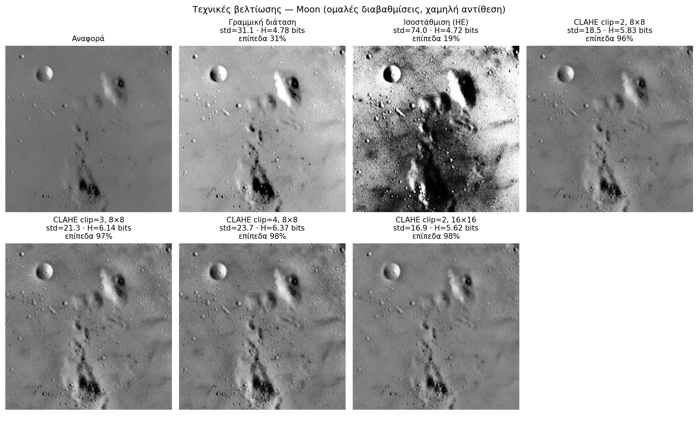
<figcaption><strong>Εικόνα 16.</strong> Moon: αναφορά, γραμμική διάταση, HE και οι τέσσερις παραλλαγές CLAHE. Η οπτική διαφορά HE / CLAHE είναι εμφανής: η HE δίνει «σκληρό», σχεδόν posterized αποτέλεσμα.</figcaption>
</figure>

<figure>
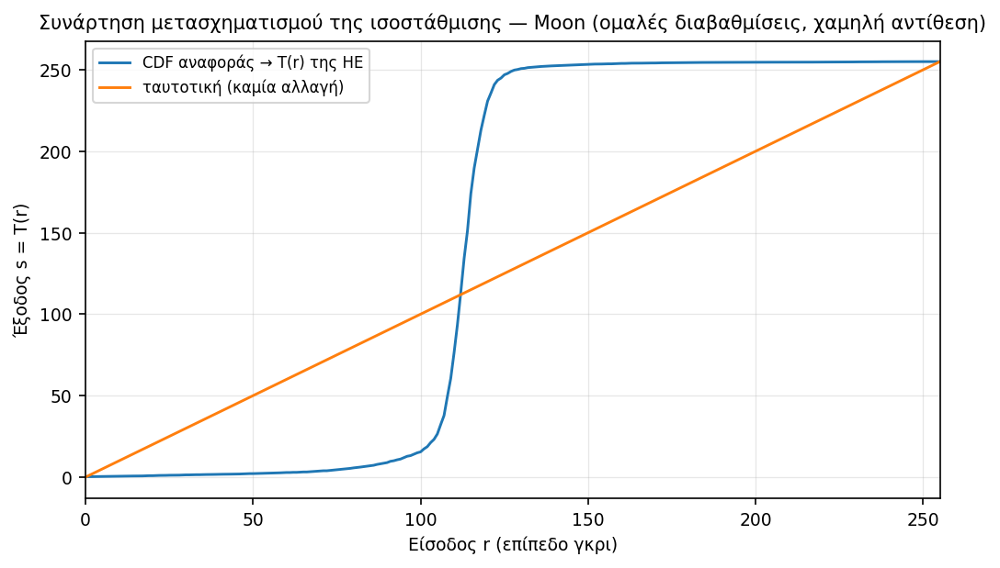
<figcaption><strong>Εικόνα 17.</strong> Οι συναρτήσεις μετασχηματισμού s = T(r). Η καμπύλη της HE είναι η CDF του ιστογράμματος: εκεί που είναι απότομη «ανοίγει» επίπεδα, εκεί που είναι επίπεδη τα <strong>συγχωνεύει</strong>.</figcaption>
</figure>

<figure>
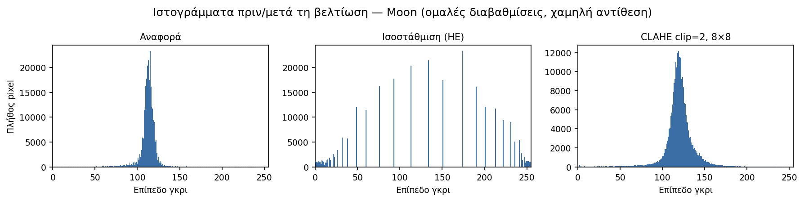
<figcaption><strong>Εικόνα 18.</strong> Ιστογράμματα πριν και μετά. Τα «κενά» στο ιστόγραμμα της HE είναι τα χαμένα επίπεδα γκρι — posterization.</figcaption>
</figure>

### 8.4 Το παράδοξο της HE

1. **Η HE «πετυχαίνει» θεαματικά και ταυτόχρονα αποτυγχάνει.** Στη Moon εκτοξεύει την
   αντίθεση από **13,33 σε 74,01** (×5,5). Αλλά η εντροπία **πέφτει** (4,885 → 4,719) και τα
   επίπεδα γκρι σε χρήση **καταρρέουν** (69,5 % → **19,1 %**).
2. **Γιατί συμβαίνει.** Η HE είναι μη γραμμική απεικόνιση **256 → 256 τιμών με
   στρογγυλοποίηση**. Όπου η CDF είναι απότομη ανοίγει τα επίπεδα, όπου είναι επίπεδη τα
   συγχωνεύει — και σε 8 bit η συγχώνευση είναι **μη αναστρέψιμη**. Η Moon έχει στενό
   ιστόγραμμα, οπότε ~200 γειτονικά επίπεδα καταρρέουν σε ~49. Το φαινόμενο λέγεται
   **posterization**.
3. **Το SSIM 0,248 είναι η ποσοτική απόδειξη.** Η καθολική καμπύλη T(r) επιβάλλεται σε
   ΟΛΗ την εικόνα ανεξάρτητα από τοπικό περιεχόμενο, και αλλοιώνει τη δομή.
4. **Η CLAHE κάνει το αντίθετο.** Ανεβάζει την εντροπία (4,885 → **5,827**, +19 %), τα
   επίπεδα σε χρήση στο **96,1 %**, και κρατά SSIM **0,877**: **προσθέτει** ορατή πληροφορία
   αντί να τη διαγράφει. Το κλειδί είναι διπλό: (α) η ισοστάθμιση είναι **τοπική** (ανά
   πλακίδιο, με παρεμβολή μεταξύ πλακιδίων), (β) το **clip limit** ψαλιδίζει το τοπικό
   ιστόγραμμα πριν τη CDF, περιορίζοντας πόσο απότομη μπορεί να γίνει η ενίσχυση.
5. **Το clip limit είναι ρυθμιστής συμβιβασμού.** clip 2 → 4 ανεβάζει την εντροπία
   (5,83 → 6,37) αλλά ρίχνει το SSIM (0,877 → 0,709): πιο επιθετική ενίσχυση = περισσότερη
   ορατή λεπτομέρεια αλλά και περισσότερη αλλοίωση.
6. **Στον Cameraman η βελτίωση προσφέρει λίγα — και αυτό είναι σωστό αποτέλεσμα.** Η εικόνα
   ήδη χρησιμοποιεί **100 %** των επιπέδων με std 73,6: δεν υπάρχει αχρησιμοποίητη δυναμική
   περιοχή να ανακτηθεί. **Η βελτίωση αντίθεσης αξίζει μόνο όταν υπάρχει αντίθεση να
   κερδηθεί** — ακριβώς γι' αυτό επιλέχθηκε η Moon στο Στάδιο 1.

### 8.5 Μέρος Β — η σειρά στην αλυσίδα

**Πίνακας 7 — Ίδια βελτίωση, δύο θέσεις στην αλυσίδα (Moon, Gauss σ = 25)**

| Στάδιο | Βελτίωση | std | PSNR | SSIM | Ευκρίνεια (% αναφοράς) |
|---|---|---|---|---|---|
| Θορυβώδης | καμία | 28,22 | 20,17 | 0,128 | 6 959 % |
| Θορυβώδης | + HE | 73,79 | 10,94 | 0,032 | **52 864 %** |
| Θορυβώδης | + CLAHE | 54,71 | 13,47 | 0,048 | 29 685 % |
| Αποκατεστημένη | καμία | 12,87 | **34,00** | **0,823** | 48 % |
| Αποκατεστημένη | + HE | 73,81 | 11,24 | 0,092 | 5 566 % |
| Αποκατεστημένη | + CLAHE | 20,49 | 23,57 | **0,506** | 332 % |

<figure>
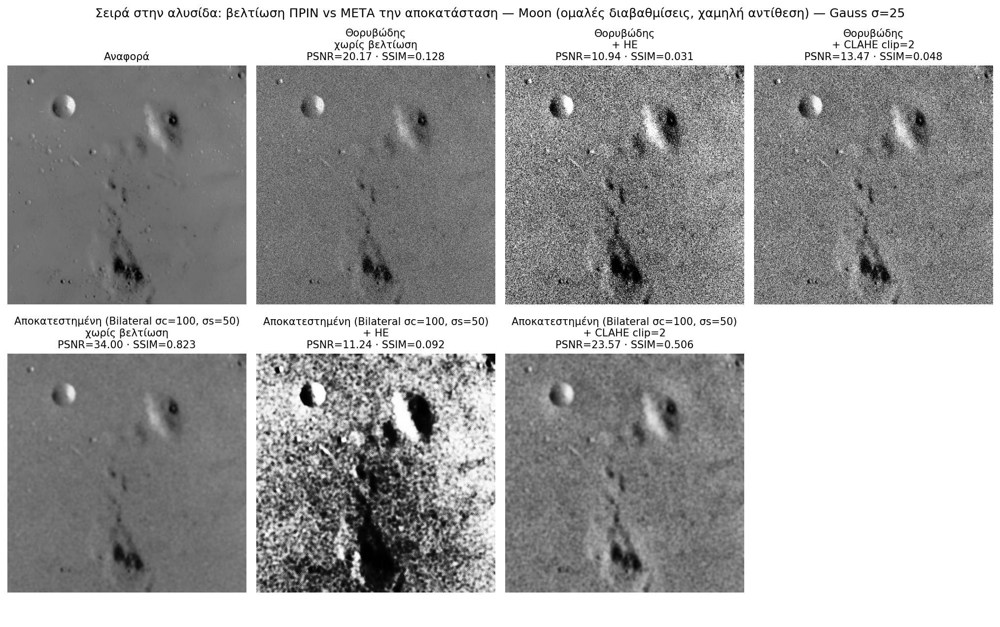
<figcaption><strong>Εικόνα 19.</strong> Moon / Gauss σ = 25: η ίδια βελτίωση πάνω στη θορυβώδη (πάνω σειρά) και πάνω στην αποκατεστημένη (κάτω σειρά). Η διαφορά δεν χρειάζεται μετρική για να φανεί.</figcaption>
</figure>

7. **Η βελτίωση δεν διακρίνει σήμα από θόρυβο — τον ενισχύει εξίσου πρόθυμα.** Η στήλη
   ευκρίνειας λειτουργεί εδώ ως **δείκτης ενίσχυσης θορύβου**: η HE πάνω στη θορυβώδη εικόνα
   την εκτοξεύει στο **52 864 %** της αναφοράς. Δεν είναι λεπτομέρεια — είναι θόρυβος που
   έγινε ορατός.
8. **Η σειρά έχει τεράστια σημασία.** Ίδια τεχνική (CLAHE), δύο σειρές: πάνω στη θορυβώδη
   δίνει SSIM **0,048**, πάνω στην αποκατεστημένη **0,506** — δεκαπλάσιο. **Πρώτα
   αποκατάσταση, μετά βελτίωση.** Η αντίστροφη σειρά ενισχύει τον θόρυβο και τον κάνει
   δυσκολότερο να αφαιρεθεί μετά, γιατί η ενίσχυση είναι μη γραμμική και δεν αντιστρέφεται.
9. **Και η σωστή σειρά έχει κόστος σε PSNR** (23,57 έναντι 34,00). Είναι αναμενόμενο, όχι
   σφάλμα: το ερώτημα δεν είναι «πόσο μοιάζει με την αναφορά» αλλά «πόσα βλέπει ο
   παρατηρητής». Στην Εικόνα 19 η αποκατεστημένη + CLAHE δείχνει κρατήρες που στην ίδια την
   αναφορά μόλις διακρίνονται.
10. **Η HE είναι ακατάλληλη σε κάθε θέση αυτής της αλυσίδας** — SSIM 0,092 ακόμη και πάνω
    στην καθαρή αποκατεστημένη εικόνα.

<div class="pagebreak"></div>

## 9. Στάδιο 7 — Ανίχνευση ακμών

### 9.1 Γιατί αυτό το στάδιο κρίνει όλη την εργασία

Η ανίχνευση ακμών είναι ο τελικός «καταναλωτής» της αλυσίδας: αν η αποκατάσταση πέτυχε,
πρέπει να φαίνεται **εδώ**, σε πραγματική εργασία όρασης, όχι μόνο σε έναν δείκτη. Είναι
ταυτόχρονα η πιο ευάλωτη στον θόρυβο πράξη, και ο λόγος είναι μαθηματικός: **η παραγώγιση
ενισχύει τις υψηλές συχνότητες** (`∂/∂x ↔ πολλαπλασιασμός με j2πu`). Ο θόρυβος ζει ακριβώς
εκεί (Στάδιο 3), άρα ενισχύεται δυσανάλογα. Γι' αυτό κάθε σοβαρός ανιχνευτής **εξομαλύνει
πρώτα**.

### 9.2 Τι υλοποιήθηκε

**Sobel** (συνιστώσες Gx, Gy, μέτρο κλίσης, κατωφλίωση σε εκατοστημόριο), **Canny** με τρία
ζεύγη κατωφλίων υστέρησης, **Canny προσαρμοστικό**, και **αξιολόγηση χάρτη ακμών** με
precision / recall / F1 και ανοχή θέσης 2 pixel (μέσω μετασχηματισμού απόστασης). Το στάδιο
έχει τρία μέρη: οι τελεστές στην **καθαρή** εικόνα (παράγουν τους χάρτες αναφοράς), οι ίδιοι
τελεστές στην **αποκατεστημένη** με πλήρη σάρωση κατωφλίων και μετρικές, και η τελική
σύγκριση **θορυβώδης έναντι αποκατεστημένης** για τις 8 περιπτώσεις × 3 ανιχνευτές.

### 9.3 Δύο μεθοδολογικές αποφάσεις που αλλάζουν το συμπέρασμα

1. **Κατωφλίωση σε εκατοστημόριο, όχι σε απόλυτη τιμή.** Κρατάμε το ισχυρότερο 8 % των
   pixel, ώστε το πλήθος των ακμών να μη μεταβάλλεται απλώς επειδή άλλαξε η αντίθεση.
2. **Ανοχή θέσης 2 pixel.** Μια ακμή μετατοπισμένη κατά 1 pixel είναι σωστά ανιχνευμένη
   ακμή, όχι σφάλμα. Χωρίς ανοχή, κάθε εξομάλυνση θα τιμωρούνταν άδικα.

<figure>
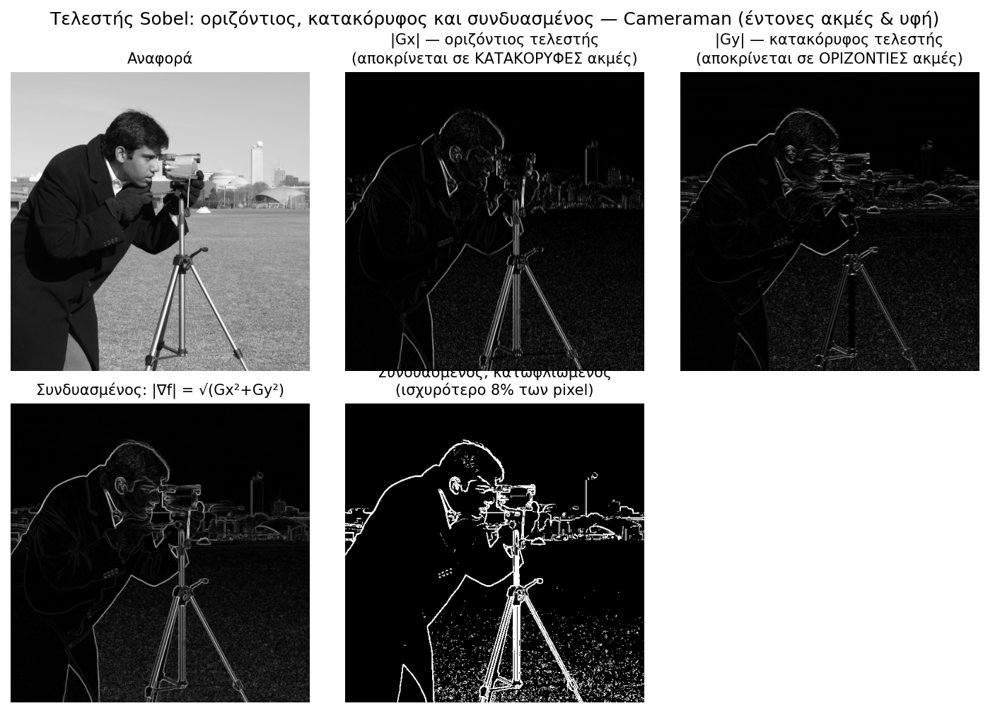
<figcaption><strong>Εικόνα 20.</strong> Cameraman: Gx, Gy, μέτρο κλίσης και κατωφλιωμένος χάρτης. Οι δύο πρώτες εικόνες δείχνουν ότι ο Sobel είναι <strong>κατευθυντικός</strong>: ο Gx αναδεικνύει κατακόρυφες ακμές, ο Gy οριζόντιες.</figcaption>
</figure>

<figure>
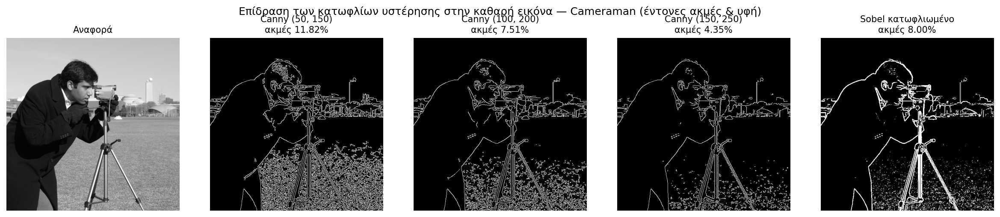
<figcaption><strong>Εικόνα 21.</strong> Επίδραση των κατωφλίων υστέρησης του Canny: 11,82 % ακμές με (50, 150) έναντι 4,35 % με (150, 250) — <strong>τριπλάσια διαφορά από τα ίδια δεδομένα</strong>.</figcaption>
</figure>

### 9.4 Αποτελέσματα

**Πίνακας 8 — F1 ανίχνευσης ακμών ως προς τον χάρτη της αναφοράς**

| Εικόνα | Υποβάθμιση | Sobel θορυβώδης | Sobel αποκατ. | Canny-προσ. θορυβ. | Canny-προσ. αποκατ. |
|---|---|---|---|---|---|
| Cameraman | Gauss σ=10 | 0,971 | 0,960 | 0,834 | **0,886** |
| Cameraman | Gauss σ=25 | 0,838 | **0,921** | 0,574 | **0,783** |
| Cameraman | S&P d=2 % | 0,588 | **0,943** | 0,689 | **0,909** |
| Cameraman | S&P d=10 % | 0,412 | **0,944** | 0,577 | **0,905** |
| Moon | Gauss σ=10 | 0,615 | **0,855** | 0,464 | **0,516** |
| Moon | Gauss σ=25 | 0,366 | **0,693** | 0,458 | 0,450 |
| Moon | S&P d=2 % | 0,282 | **0,951** | 0,403 | **0,834** |
| Moon | S&P d=10 % | 0,318 | **0,956** | 0,455 | **0,833** |

<figure>
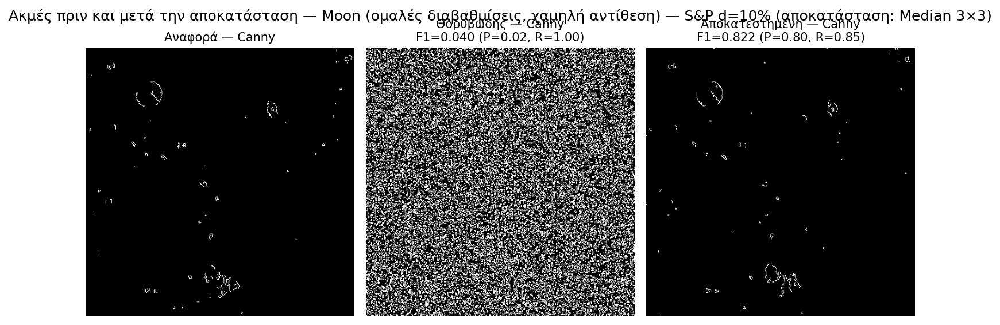
<figcaption><strong>Εικόνα 22.</strong> Moon / S&amp;P d = 10 %: χάρτες ακμών χωρίς και με αποκατάσταση. Στη θορυβώδη εικόνα ο ανιχνευτής βρίσκει χιλιάδες <em>ψεύτικες</em> ακμές — κάθε κουκκίδα θορύβου είναι απότομη μεταβολή.</figcaption>
</figure>

<figure>
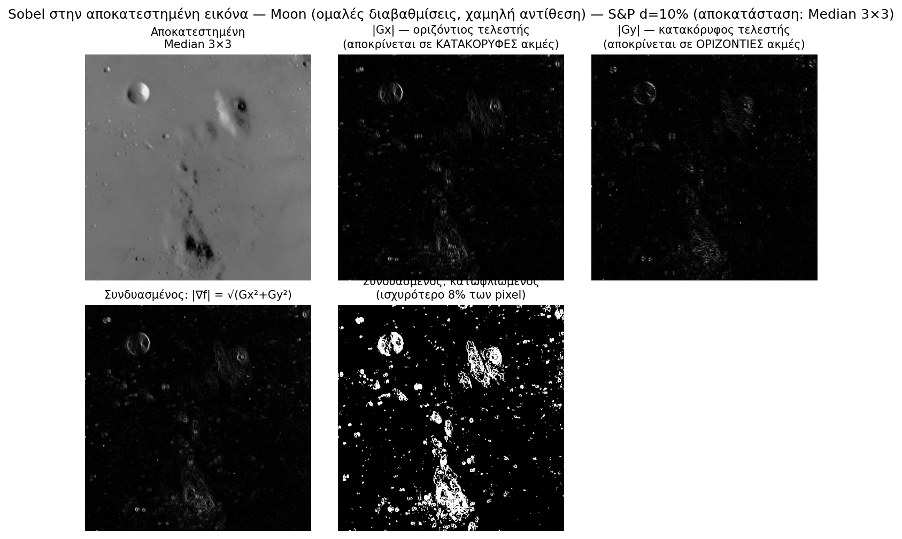
<figcaption><strong>Εικόνα 23.</strong> Πλήρες πάνελ Sobel πάνω στην <strong>αποκατεστημένη</strong> Moon / S&amp;P 10 %: οριζόντιος, κατακόρυφος, συνδυασμένος και κατωφλιωμένος χάρτης (F1 = 0,956).</figcaption>
</figure>

### 9.5 Σχολιασμός

1. **Η αποκατάσταση αποδεικνύεται χρήσιμη σε πραγματική εργασία.** Moon / S&P d = 10 %:
   το F1 του Sobel πάει από **0,318 σε 0,956** — τριπλασιασμός. Cameraman / S&P d = 10 %:
   **0,412 → 0,944**. Το ενδιάμεσο κέρδος των +23,8 dB του Σταδίου 4 **μεταφράστηκε** σε
   σχεδόν τέλεια ανίχνευση.
2. **Το μοτίβο precision/recall δείχνει τι είδους σφάλμα κάνει ο θόρυβος.** Στις θορυβώδεις
   εικόνες το **recall είναι σχεδόν 1,0** ενώ η **precision καταρρέει** (Moon / σ = 25:
   P = 0,30, R = 0,99). Ο ανιχνευτής δεν χάνει ακμές — **εφευρίσκει** ψεύτικες. Μετά την
   αποκατάσταση η precision εκτοξεύεται (0,22 → 0,96) με μικρό κόστος στο recall.
   **Ο θόρυβος δεν κρύβει ακμές· παράγει ψεύτικες.**
3. **Μία εξαίρεση, καταγεγραμμένη ειλικρινά:** Cameraman / Gauss σ = 10 με Sobel, η
   αποκατάσταση χειροτερεύει ελαφρά το F1 (0,971 → 0,960). Ο θόρυβος είναι ήπιος και η
   εικόνα πλούσια σε λεπτομέρεια, οπότε η εξομάλυνση κοστίζει περισσότερο απ' όσο κερδίζει.
   **Η αποκατάσταση δεν είναι δωρεάν — αξίζει όταν ο θόρυβος υπερβαίνει τη λεπτομέρεια που
   θυσιάζεται.**
4. **Μεθοδολογικό εύρημα: τα σταθερά κατώφλια Canny είναι άδικα σε φιλτραρισμένες εικόνες.**
   Με σταθερά (100, 200) η αποκατεστημένη έβγαζε recall ~0,47 και φαινόταν **χειρότερη** από
   τη θορυβώδη — όχι επειδή έχασε ακμές, αλλά επειδή **η εξομάλυνση μειώνει το μέτρο της
   κλίσης** ενώ τα κατώφλια έμειναν ίδια. Με κατώφλια δεμένα στην κατανομή της **κλίσης**,
   η αποκατεστημένη κερδίζει σε **7 από τις 8** περιπτώσεις. Σημειώνεται ότι ο γνωστός
   κανόνας «auto-Canny» (κατώφλια από τη διάμεσο της **έντασης**) δοκιμάστηκε και **δεν**
   λύνει το πρόβλημα: η ένταση δεν αλλάζει με την εξομάλυνση, η κλίση αλλάζει.
5. **Ο Canny δεν είναι πάντα ο νικητής.** Στη Moon ο Sobel με κατωφλίωση εκατοστημορίου
   δίνει σταθερά καλύτερο F1 (0,956 έναντι 0,833). Η **καταστολή μη μεγίστων** του Canny
   προϋποθέτει καλά ορισμένες κορυφές κλίσης· στις πολύ ομαλές μεταβάσεις της Moon η κορυφή
   είναι πλατιά και η λέπτυνση σε 1 pixel γίνεται ασταθής.
6. **Ποια κατώφλια είναι σωστά για την αποκατεστημένη εικόνα; Εξαρτάται από το πόσο βαρύ
   ήταν το φιλτράρισμα.** Στη σάρωση πάνω στην αποκατεστημένη τα **υψηλά** κατώφλια
   (150, 250) κερδίζουν σε **5 από τις 8** περιπτώσεις και τα **χαμηλά** (50, 150) στις
   υπόλοιπες **3** — που είναι ακριβώς οι περιπτώσεις με τον βαρύτερο θόρυβο, όπου η
   αποκατάσταση χρειάστηκε την πιο επιθετική εξομάλυνση. Η precision μένει ψηλά σε κάθε
   ρύθμιση (0,798–0,999), δηλαδή οι ψεύτικες ακμές έχουν ήδη εξαλειφθεί· αυτό που κρίνει
   τον νικητή είναι σχεδόν αποκλειστικά το **recall** — και το recall είναι ακριβώς αυτό που
   θυσιάζει ένα υψηλό κατώφλι.
7. **Ο κατωφλιωμένος Sobel νικά τον Canny σε 8 από τις 8 γραμμές της αποκατεστημένης**
   (F1 0,693–0,956 έναντι 0,375–0,881). Δεν σημαίνει ότι είναι «καλύτερος ανιχνευτής»:
   σημαίνει ότι η κατωφλίωση σε **εκατοστημόριο** προσαρμόζεται αυτόματα στην εικόνα, ενώ
   τα **απόλυτα** κατώφλια όχι.

<div class="pagebreak"></div>
## 10. Στάδιο 8 — Συγκεντρωτική αξιολόγηση

### 10.1 Πώς έγινε η σύγκριση

Όλες οι μέθοδοι αποκατάστασης των Σταδίων 4 και 5 μπήκαν σε **κοινή λίστα** και κρίθηκαν με
ταυτόσημα κριτήρια: 12 χωρικά φίλτρα + 5 οικογένειες χαμηλοπερατών × 9 συχνότητες αποκοπής
= **57 μέθοδοι ανά περίπτωση**, δηλαδή 456 αξιολογήσεις συνολικά. Έτσι η σύγκριση «χωρικό
έναντι συχνοτήτων» γίνεται μία φορά, καθαρά, χωρίς να ευνοείται καμία πλευρά από την επιλογή
παραμέτρου.

<figure>
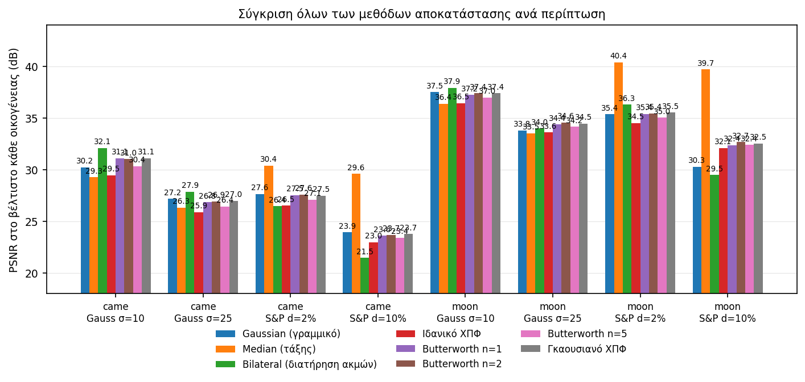
<figcaption><strong>Εικόνα 24.</strong> Όλες οι οικογένειες φίλτρων, όλες οι περιπτώσεις, σε ένα ραβδόγραμμα. Το μοτίβο είναι εμφανές: το Median κυριαρχεί στις τέσσερις περιπτώσεις S&amp;P, το Bilateral / Butterworth στις τέσσερις γκαουσιανές.</figcaption>
</figure>

### 10.2 Ο νικητής ανά περίπτωση

**Πίνακας 9 — Καλύτερη μέθοδος αποκατάστασης ανά περίπτωση**

| Εικόνα | Υποβάθμιση | PSNR πριν | Νικητής | PSNR μετά | ΔPSNR | Χωρικό − Συχνοτήτων |
|---|---|---|---|---|---|---|
| Cameraman | Gauss σ=10 | 28,22 | Bilateral σc=25 | 32,09 | +3,86 | +0,98 dB |
| Cameraman | Gauss σ=25 | 20,58 | Bilateral σc=50 | 27,86 | +7,28 | +0,88 dB |
| Cameraman | S&P d=2 % | 21,76 | **Median 3×3** | 30,40 | +8,64 | **+2,81 dB** |
| Cameraman | S&P d=10 % | 14,75 | **Median 3×3** | 29,58 | +14,83 | **+5,84 dB** |
| Moon | Gauss σ=10 | 28,12 | Bilateral σc=25 | 37,94 | +9,82 | +0,54 dB |
| Moon | Gauss σ=25 | 20,17 | **Butterworth n=2, D0=0,15** | 34,59 | +14,41 | **−0,59 dB** |
| Moon | S&P d=2 % | 22,91 | **Median 3×3** | 40,42 | +17,51 | **+4,88 dB** |
| Moon | S&P d=10 % | 15,91 | **Median 3×3** | 39,72 | +23,82 | **+7,06 dB** |

### 10.3 Ο συγκεντρωτικός πίνακας της αλυσίδας

**Πίνακας 10 — PSNR (dB) / SSIM σε κάθε βήμα της αλυσίδας**

| Εικόνα | Υποβάθμιση | 1. Υποβαθμισμένη | 2. Καλύτερο χωρικό | 3. Καλύτερο συχνοτικό | 4. Μετά τη βελτίωση |
|---|---|---|---|---|---|
| Cameraman | Gauss σ=10 | 28,22 / 0,610 | **32,09** / 0,865<br>*Bilateral σc=25* | 31,10 / 0,784<br>*Γκαουσιανό D0=0,60* | 22,74 / 0,739 |
| Cameraman | Gauss σ=25 | 20,58 / 0,302 | **27,86** / 0,674<br>*Bilateral σc=50* | 26,97 / 0,652<br>*Γκαουσιανό D0=0,30* | 20,33 / 0,431 |
| Cameraman | S&P d=2 % | 21,76 / 0,629 | **30,40** / 0,867<br>*Median 3×3* | 27,59 / 0,702<br>*Butterworth n=2 D0=0,45* | 22,42 / 0,791 |
| Cameraman | S&P d=10 % | 14,75 / 0,192 | **29,58** / 0,858<br>*Median 3×3* | 23,75 / 0,539<br>*Γκαουσιανό D0=0,20* | 22,11 / 0,774 |
| Moon | Gauss σ=10 | 28,12 / 0,444 | **37,94** / 0,907<br>*Bilateral σc=25* | 37,40 / 0,906<br>*Butterworth n=2 D0=0,30* | 25,12 / 0,708 |
| Moon | Gauss σ=25 | 20,17 / 0,128 | 34,00 / 0,823<br>*Bilateral σc=100* | **34,59** / 0,879<br>*Butterworth n=2 D0=0,15* | 24,17 / 0,695 |
| Moon | S&P d=2 % | 22,91 / 0,480 | **40,42** / 0,964<br>*Median 3×3* | 35,54 / 0,892<br>*Γκαουσιανό D0=0,15* | 25,71 / 0,892 |
| Moon | S&P d=10 % | 15,91 / 0,070 | **39,72** / 0,965<br>*Median 3×3* | 32,67 / 0,872<br>*Butterworth n=2 D0=0,10* | 25,63 / 0,883 |

<p class="note">Έντονα το καλύτερο από τα δύο πεδία. Βήμα 4 = CLAHE clip = 2 πάνω στην
καλύτερη αποκατάσταση της γραμμής. Πηγή: <code>results/stage8_summary/pipeline_summary.csv</code>.</p>

### 10.4 Πώς διαβάζεται η στήλη 4 — το PSNR πέφτει, και είναι αναμενόμενο

Σε κάθε γραμμή το PSNR μετά τη βελτίωση είναι χαμηλότερο από το PSNR της αποκατάστασης
(π.χ. 32,09 → 22,74). **Δεν είναι σφάλμα και δεν σημαίνει ότι η CLAHE χάλασε την εικόνα.**
Το PSNR μετρά **pixel-προς-pixel απόκλιση από την αναφορά**, ενώ η βελτίωση **σκοπίμως**
αλλάζει την κατανομή των εντάσεων για να ανεβάσει την τοπική αντίθεση:

- Η **αποκατάσταση** είναι πρόβλημα αντιστροφής — στόχος της είναι το ground truth, άρα το
  PSNR/SSIM είναι το σωστό κριτήριο και **πρέπει** να ανεβαίνει.
- Η **βελτίωση** δεν είναι πρόβλημα αντιστροφής — στόχος της είναι μια πιο ευανάγνωστη
  εικόνα, **όχι** πιο κοντινή στην αναφορά. Κρινόμενη με PSNR είναι εξ ορισμού χαμένη.

Το κέρδος της μετριέται με άλλα μεγέθη, και εκεί το πρόσημο αντιστρέφεται:

**Πίνακας 11 — Το κέρδος της βελτίωσης εκεί που φαίνεται**

| Εικόνα | Υποβάθμιση | Εντροπία: υποβαθμ. → αποκατ. → **βελτ.** | Επίπεδα γκρι σε χρήση: πριν → **μετά** |
|---|---|---|---|
| Cameraman | Gauss σ=25 | 7,71 → 7,26 → **7,71** | 95,70 % → **98,05 %** |
| Cameraman | S&P d=10 % | 7,07 → 7,11 → **7,64** | 99,61 % → **99,61 %** |
| Moon | Gauss σ=25 | 6,84 → 5,03 → **6,08** | 91,41 % → **94,53 %** |
| Moon | S&P d=2 % | 4,94 → 4,82 → **5,73** | 68,75 % → **96,09 %** |
| Moon | S&P d=10 % | 4,96 → 4,83 → **5,75** | 69,14 % → **96,88 %** |

Η **Moon με S&P** είναι η καθαρότερη περίπτωση: η CLAHE ανεβάζει τα επίπεδα γκρι σε χρήση
από **69 % σε 97 %** και την εντροπία κατά ~0,9 bits. Είναι πραγματικό κέρδος
αναγνωσιμότητας, το οποίο το PSNR **δεν μπορεί να δει**· το SSIM, που κοιτάζει δομή και όχι
απόλυτες τιμές, το βλέπει εν μέρει (μένει στο 0,89 ενώ το PSNR κατρακυλά).

**Μια παγίδα σε αυτόν τον πίνακα:** η εντροπία της **υποβαθμισμένης** είναι συχνά μεγαλύτερη
από της αποκατεστημένης (Moon / σ = 25: 6,84 έναντι 5,03). Δεν έχει περισσότερη πληροφορία —
ο **θόρυβος** ανεβάζει την εντροπία επειδή απλώνει τυχαία το ιστόγραμμα. Η εντροπία μετρά
αβεβαιότητα, και ο θόρυβος είναι αβεβαιότητα. Γι' αυτό έχει νόημα ως κριτήριο **μόνο**
μεταξύ εικόνων με τον ίδιο θόρυβο — δηλαδή πριν και μετά τη βελτίωση, όπως χρησιμοποιείται
εδώ.

### 10.5 Η αλυσίδα από άκρη σε άκρη

**Πίνακας 12 — Από το PSNR στην ανίχνευση ακμών**

| Εικόνα | Υποβάθμιση | PSNR πριν → μετά | F1 ακμών χωρίς → με αποκατάσταση |
|---|---|---|---|
| Cameraman | Gauss σ=25 | 20,58 → 27,86 | 0,838 → **0,921** |
| Cameraman | S&P d=10 % | 14,75 → 29,58 | 0,412 → **0,944** |
| Moon | Gauss σ=25 | 20,17 → 34,59 | 0,366 → **0,733** |
| Moon | S&P d=10 % | 15,91 → 39,72 | 0,318 → **0,956** |

<figure>
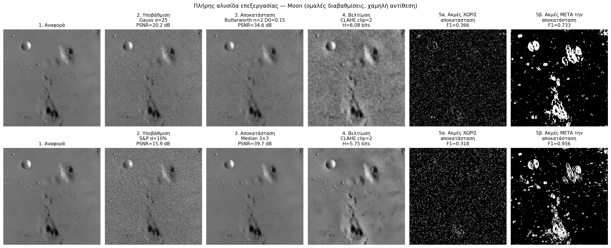
<figcaption><strong>Εικόνα 25.</strong> Moon — η πλήρης αλυσίδα: Αναφορά → Υποβάθμιση → Αποκατάσταση → Βελτίωση → Ακμές χωρίς και με αποκατάσταση.</figcaption>
</figure>

<figure>
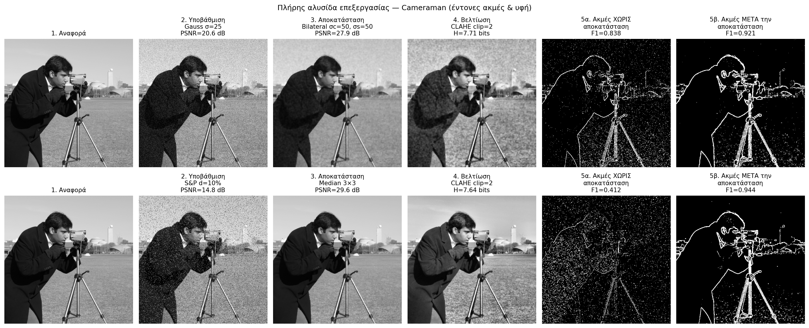
<figcaption><strong>Εικόνα 26.</strong> Cameraman — η ίδια αλυσίδα σε εικόνα υψηλής αντίθεσης και πλούσιας υφής.</figcaption>
</figure>

<div class="pagebreak"></div>

## 11. Συμπεράσματα

1. **Δεν υπάρχει καθολικά καλύτερο φίλτρο — υπάρχει καλύτερο φίλτρο για κάθε ΤΥΠΟ θορύβου.**
   Στις 8 περιπτώσεις οι νικητές μοιράζονται με απόλυτη κανονικότητα: **Median** και στις 4
   περιπτώσεις κρουστικού θορύβου, **Bilateral / Butterworth** και στις 4 περιπτώσεις
   γκαουσιανού. Καμία εξαίρεση.
2. **Η επιλογή πεδίου έχει σημασία μόνο για τον κρουστικό θόρυβο.** Στον γκαουσιανό η
   διαφορά χωρικού–συχνοτικού είναι **±1 dB** — πρακτικά ισοδύναμα, όπως επιβάλλει το
   θεώρημα συνέλιξης, αφού πρόκειται για την ίδια πράξη. Στον S&P η διαφορά εκτοξεύεται στα
   **+2,8 έως +7,1 dB** υπέρ του χωρικού. **Το είδος του θορύβου, όχι το πεδίο, καθορίζει τη
   λύση.**
3. **Η βέλτιστη συχνότητα αποκοπής προβλέπεται, δεν αναζητείται.** Το `r(SNR=1)` της
   ανάλυσης φάσματος ταυτίστηκε με το πειραματικά βέλτιστο `D0` σε **8/8** περιπτώσεις. Η
   ανάλυση στο πεδίο συχνοτήτων δεν είναι περιγραφικό στάδιο — είναι εργαλείο σχεδιασμού.
4. **Όσο χειρότερη η υποβάθμιση, τόσο μεγαλύτερο το κέρδος** (+3,86 dB στην ηπιότερη
   περίπτωση, +23,82 dB στη χειρότερη) — αλλά ποτέ επιστροφή στην αναφορά. Η υποβάθμιση
   καταστρέφει πληροφορία μη αναστρέψιμα· η αποκατάσταση κάνει τη βέλτιστη **εικασία**, δεν
   αντιστρέφει.
5. **Μία μετρική δεν αρκεί.** PSNR και SSIM δίνουν διαφορετικό νικητή σε **2 από τις 8**
   περιπτώσεις, και υπάρχει τουλάχιστον μία ρύθμιση όπου το PSNR ανεβαίνει κατά 4,75 dB ενώ
   το SSIM **πέφτει** (ιδανικό φίλτρο, ringing). Δεν είναι θόρυβος μέτρησης — είναι
   διαφορετικοί ορισμοί του «καλού»: μέσο τετραγωνικό σφάλμα έναντι δομικής ομοιότητας.
6. **Αποκατάσταση και βελτίωση δεν είναι εναλλακτικές — είναι διαδοχικά βήματα με
   συγκεκριμένη σειρά.** Η ίδια CLAHE δίνει SSIM 0,048 πάνω στη θορυβώδη και 0,506 πάνω στην
   αποκατεστημένη. Και οι δύο κρίνονται με **διαφορετικά** μεγέθη: η πρώτη με PSNR/SSIM, η
   δεύτερη με εντροπία και αξιοποίηση δυναμικής περιοχής.
7. **Η αλυσίδα λειτουργεί ως σύνολο, και το αποδεικνύει το τελευταίο στάδιο.** Το κέρδος του
   Σταδίου 4 δεν έμεινε στο χαρτί: το F1 ανίχνευσης ακμών πάει **0,318 → 0,956** (Moon /
   S&P 10 %) και **0,412 → 0,944** (Cameraman / S&P 10 %).
8. **Το περιεχόμενο της εικόνας καθορίζει τι είναι εφικτό.** Η Moon κερδίζει σχεδόν
   διπλάσια dB από τον Cameraman στην ίδια υποβάθμιση, επειδή είναι ομαλή: η υπόθεση «οι
   γείτονες μοιάζουν» — πάνω στην οποία στηρίζεται **κάθε** μέθοδος αποθορυβοποίησης —
   ισχύει σχεδόν παντού. Αντίστροφα, στο Στάδιο 6 ο Cameraman δεν είχε τίποτα να κερδίσει
   από τη βελτίωση αντίθεσης, ενώ η Moon μεταμορφώθηκε.
9. **Η μεθοδολογία μετράει όσο και ο αλγόριθμος.** Τρεις φορές μέσα στην εργασία μια
   μεθοδολογική επιλογή άλλαξε το συμπέρασμα: ο αποκλεισμός της DC από τις μετρήσεις
   ενέργειας (Στάδιο 3), η σύγκριση οικογενειών στα δικά τους βέλτιστα (Στάδιο 4), και τα
   κατώφλια Canny δεμένα στη στατιστική της κλίσης (Στάδιο 7) — χωρίς το τελευταίο, η
   αποκατάσταση φαινόταν να **βλάπτει** την ανίχνευση ακμών.

### 11.1 Περιορισμοί και πιθανές επεκτάσεις

- Η υποβάθμιση περιορίστηκε σε **θόρυβο**· δεν μοντελοποιήθηκε **θόλωση** (κίνησης ή
  εκτός εστίασης). Η προσθήκη της θα δικαιολογούσε αντίστροφα φίλτρα και **φίλτρο Wiener**,
  που είναι η φυσική συνέχεια των Σταδίων 4–5.
- Δοκιμάστηκαν **δύο** εικόνες αναφοράς. Η επιλογή τους ήταν σκόπιμα ακραία, αλλά ένα
  μεγαλύτερο σύνολο θα επέτρεπε στατιστική σημαντικότητα αντί για παρατήρηση μοτίβου.
- Η αξιολόγηση είναι πλήρως **αντικειμενική**· δεν έγινε υποκειμενική αξιολόγηση από
  παρατηρητές, η οποία είναι το φυσικό κριτήριο για το στάδιο της βελτίωσης.
- Σύγχρονες μέθοδοι αποθορυβοποίησης (**non-local means**, **BM3D**, νευρωνικά δίκτυα)
  βρίσκονται εκτός της ύλης αλλά θα αποτελούσαν φυσικό σημείο σύγκρισης για το πόσο
  απέχουν τα κλασικά φίλτρα από το σημερινό state of the art.

<div class="pagebreak"></div>

## 12. Αναπαραγωγή των αποτελεσμάτων

```bash
python -m pip install -r requirements.txt
python main.py                # και τα 8 στάδια με τη σειρά (~2 λεπτά)
python main.py --stage 4 5    # επιλεκτική εκτέλεση σταδίων
```

Με `RANDOM_SEED = 631` και ανά πείραμα γεννήτρια, **κάθε αριθμός αυτής της αναφοράς
αναπαράγεται ακριβώς**, ανεξάρτητα από τη σειρά εκτέλεσης των σταδίων. Η πλήρης εκτέλεση
παράγει 271 αρχεία στο `results/`.

**Πού βρίσκεται τι**

| Αρχείο | Περιεχόμενο |
|---|---|
| `results/stage1_reference/reference_stats.csv` | Πίνακας 1 |
| `results/stage2_degradation/degradation_metrics.csv` | Πίνακας 2 |
| `results/stage3_fft/spectrum_metrics.csv` | Πίνακας 3 — περιλαμβάνει τη στήλη `r(SNR=1)` |
| `results/stage4_spatial/spatial_sweep.csv` | και τα 96 πειράματα· `spatial_best.csv` = Πίνακας 4 |
| `results/stage5_frequency/frequency_sweep.csv` | και τα 360 πειράματα· `frequency_best.csv` = Πίνακας 5 |
| `results/stage6_enhancement/enhancement_metrics.csv` | Πίνακας 6· `enhancement_chain.csv` = Πίνακας 7 |
| `results/stage7_edges/edge_quality.csv` | Πίνακας 8· `edge_thresholds_restored.csv` = σάρωση κατωφλίων |
| `results/stage8_summary/pipeline_summary.csv` | Πίνακας 10 (ο κύριος συγκεντρωτικός) |
| `results/stage8_summary/overall_best.csv` | Πίνακας 9, με νικητές κατά PSNR **και** κατά SSIM |
| `results/stage8_summary/pipeline_diagnostics.csv` | Πίνακες 11–12 (εντροπία, επίπεδα, F1) |
| `report/stage_notes.md` | αναλυτικές σημειώσεις ανά στάδιο |

## 13. Βιβλιογραφία

1. R. C. Gonzalez, R. E. Woods, *Digital Image Processing*, 4th ed., Pearson, 2018.
2. Z. Wang, A. C. Bovik, H. R. Sheikh, E. P. Simoncelli, «Image quality assessment: from
   error visibility to structural similarity», *IEEE Trans. Image Processing*, 13(4), 2004.
3. J. Canny, «A Computational Approach to Edge Detection», *IEEE Trans. PAMI*, 8(6), 1986.
4. C. Tomasi, R. Manduchi, «Bilateral Filtering for Gray and Color Images»,
   *Proc. ICCV*, 1998.
5. K. Zuiderveld, «Contrast Limited Adaptive Histogram Equalization», *Graphics Gems IV*,
   1994.
6. Τεκμηρίωση OpenCV 4.x — <span class="url">docs.opencv.org</span> · Τεκμηρίωση
   scikit-image — <span class="url">scikit-image.org</span>.
